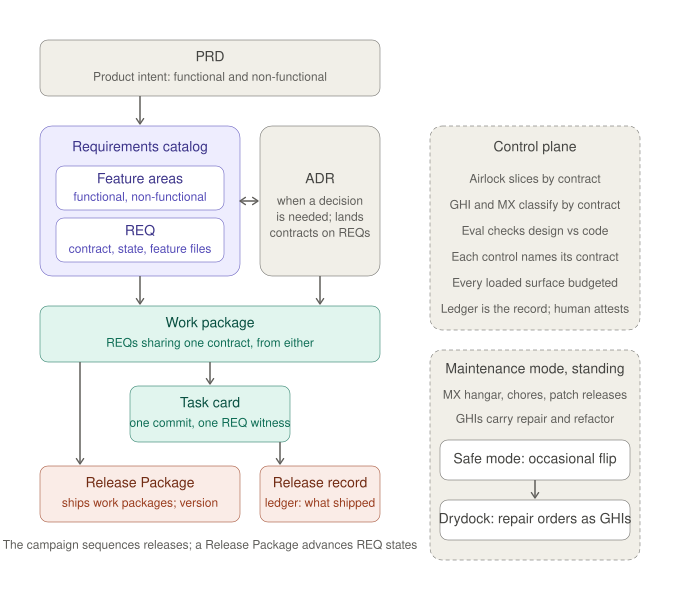

# Safe mode to civil rule — the harbor pilotage contract

Status: **RATIFIED 2026-10-15** (operator, verbatim: *"ratify the contract, draft the three
catalog shapes"*); **AMENDED 2026-10-17** to the ratified drydock plan (operator rulings of that
day, § Rulings of 2026-10-17). Drafted 2026-10-15 in session `4fd13b45-724e-4433-ab23-fd6c5df2b932`.
This file is the binding text; the campaign plan carries a pointer entry at
[`build-to-1.0-campaign-2026-09-20.md`](build-to-1.0-campaign-2026-09-20.md)
§ Amendments 2026-10-15 so that the plan, which the orientation and every session read for
sequencing, knows the phase is in force and where its terms are. The sections the 2026-10-17
amendment replaced are kept verbatim under § Superseded on 2026-10-17 as a record.

## Authority

> This contract is the first instance of `docs/governance/safe-mode-doctrine.md`; the
> reusable shape is `.gzkit/templates/safe_mode_contract.md` (entrenched 2026-10-16).

Operator (`g0`), verbatim, 2026-10-15, in order:

> I basically want a VERY POWERFUL model to take over, like a harbor pilot, and bring me
> into port. we can then resume gzkit's normal ceremony. BOOK THAT MODEL NOW.

> this is a TEMPORARY ARRANGEMENT until we get to port and dry dock. undeestood?

> get me a contract for this temporary arrangement and a plan to leave this "martial law"
> - this is a phase that should yield back to the magna carta. From this martial law back
> to "civil control."

> I wanted to PLAN in Fable, but not do all the work in fable.

> contract for entering and exiting martial law so I can resume, using the redesign, back
> towards the magna carta.

> in the meantime, you can take control of everything. I think the ledger writing still
> matters, but let's talk about that.

> martial law to get us on the diagram's plan including control plane and work/design
> modularization, then a return to magna carta (civilian rule)

Each is on the insights file at the time it was given.

Operator (`g0`), verbatim, 2026-10-17, the drydock's purpose restated after two days of drift:

> safe mode isn't here to drive req/feature work, it is for deep repairs/realignments

> When I told you take charge and use a deep, rich model like Fable to plan, it was to plan what
> the dry dock order of work would be, right? What are we retooling, redesigning, reconfiguring?

> your whole dry dock plan was ill conceived - can we get the purpose of safe mode and dry dock
> clear please?

## Purpose

Safe mode is an occasional flip inside the standing maintenance mode (the Maintenance Hangar, the
chores, the patch releases, and the GitHub issues that carry repair and refactor work). It lowers
the ceremony's constraints and most of its safeguards so that structure can be re-rigged,
reconfigured, retooled and restructured quickly, and it is turned off when that is done. Operator,
2026-10-17, verbatim:

> Safe mode has to be a way to quickly, without all the uh, constraints of the ceremony and all
> those other safeguards, which are important, to be able to just lower all that, to be able to
> make the re-rigging, reconfiguring, retooling, restructuring, and all that. But once we do that,
> we then want to turn off safe mode and return to normal operations under the new structures.

This period is a drydock: the ship is out of the water so the structure can be repaired and
realigned. It designs and lands the new structures and does not populate them (operator, verbatim:
*"yes, repair and realign the structure, don't populate it"*). The new structures are the general
arrangement below. Normal voyages, ordinary operations under them (work-package management,
release management, the feature and requirement backlog), resume when safe mode is turned off.

A drydock session holds repair orders. A repair order is the maintenance mirror of the work
package: one bounded repair with a scope, a witness and an owner, recorded to the ledger, and held
as a GitHub issue under the repair tagging scheme once RO-5 lands it (operator, verbatim: *"dry
dock orders can have repair orders... Those can still go over to the ledger. And for all I know, we
might even be able to make them as a part of the GitHub issue system, which I'd be fine with"*).

## The general arrangement



Redrawn 2026-10-17 from § Entry of the 2026-10-15 text and the operator's rulings of that day; the
pilot's original drawing of 2026-10-15 was made outside this repository and is not recoverable.
Verified from first principles the same day (§ Rulings of 2026-10-17). The bands, top to bottom:

| Band | Carrier | Holds | Relation downward |
|---|---|---|---|
| Product intent | PRD | functional requirements (`FR-nnn`) and non-functional requirements (§7 quality attributes) | feature areas trace to an FR or a quality attribute |
| The product's truth, and decisions, as peers | Requirements catalog, beside the ADR | Catalog: feature areas, first-class and typed functional or non-functional; REQs, each in one area, carrying its contract, state, revision history and its legacy id as an alias; Gherkin feature files prove functional REQs where there is a user (the `gz` CLI). ADR: a decision and its rationale, made only where a decision is needed; it lands contracts on the REQs it touches and carries no version and no release. The REQ–ADR link is two-way for those REQs. Not every requirement or feature needs an ADR | a work package is cut from the catalog directly in the ordinary case, or from an ADR where one exists |
| Labor | Work package, then task cards | a work package selects the REQs sharing one contract, from the catalog or from an ADR, and always names its REQs; a task card is the increment: one commit, one trailer, one commit-grain witness citing the REQ | the Release Package ships work packages; the release record carries the task cards' witnesses |
| Version | Release Package, and the ledger release record | the Release Package (planned, in-flight, released) selects the work packages that ship and says which REQ states advance in the version; the version lives here. The ledger release record says what actually shipped. The campaign sequences releases; a Release Package says what one release contains | — |

The rails: the control plane reads the contract (the airlock derives its slice from the contract's
modules; GHIs and MX visits classify by the contract they repair; eval checks module design
against module code; every control names the contract it protects; every surface an agent loads
is within a witnessed budget; the ledger is the record and the human attests). Maintenance mode is
standing (the hangar, the chores, the patch releases; GHIs carry repair and refactor work, never
feature or requirements work); safe mode is an occasional flip inside it; a drydock is one session
of safe mode holding repair orders.

There is no bounded-advance document. The feature area groups the requirements and the Release
Package selects the work packages that ship together, so which work packages advance a feature
together is a query over those records.

**Amended 2026-10-18.** The operator ruled [the requirements model](ieee/requirements-model.md):
a work package delivers exactly one outcome (an outcome's REQs are those sharing its contract), and
the Release Package selects outcomes, not REQ states. Where the table above says otherwise, that
model governs. The engineering-order rung of the 2026-10-05 ladder is
retired (operator, verbatim: *"A, no separate document — retire the engineering order rung"*);
the ladder's other rungs stand, and identifiers still migrate at 1.0 with aliases before it.

Every arrow is realizable by a stored field on one condition the as-built tree violates: REQ
identity independent of the ADR and the work package. Today the ADR's semver is embedded in every
REQ, TASK and OBPI id, so the drawing is a target until that seam lands (RO-2).

## What is suspended, and what is not

Suspended while `.gzkit/mx.json` carries `mode: safe`, by the ruling of 2026-10-17 (R6, "A"):

- Every guard outside the four below drops to advisory, as the Maintenance Hangar's do, and the
  hard-gate exit re-runs every guard at full strength. In force since RO-0's second act: the
  checkpoint demotes under either mode and the pipeline gate honors the marker.
- The IRON LAW's initiation clause, for repair orders: the session cuts, authors and executes
  repair orders toward the general arrangement without an initiation per order.
- Brief ceremony. No OBPI is initiated or completed under safe mode; OBPI completion is work in the
  paradigm the drydock replaces (R4; operator, verbatim: *"I don't know why you would do an OBPI,
  which is actually completed work in the old paradigm, when I'm still actually discussing what the
  new paradigm might look like"*).

Not suspended, under any reading:

- Gate 5. A completion is attested by the operator's own words or it is not complete.
- The ledger as system of record, written only through `gz` commands; never hand-edited.
- The operator-PII rule. The Prime Directive.
- No control is removed. Lowered to advisory is not removed; the exit restores it.
- Rulings. Structure is decided by the operator on the session's draft.

## Division of labor

- **The session** appraises, plans, measures, drafts and rules with the operator, and executes a
  repair order itself only when it is the measurement's own finding and small enough to read in
  one sitting (operator, 2026-10-16: *"fable extra is expensive if you have a deterministic plan
  you are now executing"*).
- **Cheaper sessions** execute the deterministic repair orders under § Records.
- **The operator** rules every structural question, with the facts and at most three options,
  enters and exits through the `gz-mx` skill, and attests.

## Mandate

1. Cut what every agent loads to a witnessed budget, each cut measured for effect.
2. Give REQ, TASK and release identity independent of the ADR, by alias and resolver, renaming
   nothing before 1.0.
3. Land the requirements store and the feature-area registry as empty structure, with their
   validators and the BDD alignment check.
4. Detach the release from the ADR: one release shape, the Release Package with the ledger release
   record, and `gz closeout` keyed to it.
5. Land the work-package, task-card and repair-order structure, with the repair tagging scheme for
   GitHub issues.
6. Retire the canon the general arrangement contradicts, with retention maps.
7. Realign the toolchain to Astral's project discipline for gzkit and every project it scaffolds:
   each fact declared once where uv, Ruff and ty read it, Astral's tools used to the maximum,
   Python 3.14 with stdlib first (added 2026-10-19, operator: *"4. A we are in dry dock"*).
8. Dispose of the in-flight work and hand back.

## Records

- Every change is one commit, `fix(<scope>): … (GHI #N)` or `feat(<scope>): …`, with a `Task:`
  trailer naming its repair order (`TASK-ro<n>-<slug>` until the repair tagging scheme lands), a
  failing test observed before a code change, and `gz arb red --commit <sha>` run after it with its
  verdict recorded; an `undriven` verdict is repaired in the same commit before it counts.
- Every operator ruling is an insight record when given and an `[operator-ruled]` handoff entry.
- Every session ends with a handoff citing this file and listing the commits since the last.
- § Passage log is appended per act with bytes or counts before and after.
- § Repair orders is the register of this drydock until RO-5 moves repair orders to GitHub issues;
  an order's state moves only by an act in the passage log.

## Repair orders

In dependency order. RO-1 and RO-7 run in parallel with the rest on cheaper sessions. Each names
the band of the general arrangement it serves.

| Order | Serves | What it lands | Witness | Owner |
|---|---|---|---|---|
| RO-0 | the drydock itself | this contract rewritten to the ratified plan with the drawing saved beside it; the doctrine page and the contract template to match; safe mode lowering every guard but the four to advisory while the marker is open (R6); the uncommitted 2026-10-17 drift disposed; amended 2026-10-18 (requirements model § 11): operator rulings reach the ledger as `insight_recorded` pointers (`d7e332190`), and the contract is pinned at safe-mode entry and on each committed amendment (`e621a4d2c`) | `mkdocs build --strict`; `gz validate --distribution`; the guard tests; `gz validate --insights-shape`; `tests/mx/test_contract_pin.py` | the session |
| RO-1 | control plane | the bleeding stopped: session-start text under 4 KB on one channel; the dead `instruction-router` hook removed; skill descriptions to one sentence, under 6,000 chars in total; rule version banners lifted to rule-version-history; the governance read mandate pointed at the Coverage Ledger section; the budget witness extended to every loaded surface, measuring the skills that load; from 2026-10-18 each remaining cut is chosen by cause: a clause answering one recorded incident (special cause) moves to a rationale record, one answering a recurring pattern (common cause) stays, and a single failure becomes a rule only on recurrence: at least the threshold in `data/recurrence_threshold.json` (3) of cited insight or GHI records, each pair a session lease apart, checked by `gz insights recurrence` (ruled 2026-10-18) | `gz validate --instructions-files-budget` over every surface; the proof file; WP-16's effectiveness read per cut | cheaper sessions (GHIs #1246, #1249, #1252) |
| RO-2 | catalog, labor, version | the keystone: one id-resolution seam shared by every reader (phase 1 of `ADR-pool.identifier-ladder-migration`, pulled forward by R5); explicit parent fields on REQ and TASK read everywhere the regex sites recover them today; the grammar copies replaced by one body per kind (re-measured 2026-10-18: about 118 independent copies and 28 spelling-derived parents, not the nine first written); no identifier changes; the resolver tells a reused numeric prefix apart by slug, rename event or parked state (`OBPI-0.28.0-01`); before-figures in the passage log (2026-10-18); specified 2026-10-18 in [the RO-2 specification](harbor-ro2-identity-seam.md) as one order in five tranches (operator: *"One RO, tranches (Rec.)"*) | `gz validate --id-seam`: a shrink-only baseline of the sites outside the seam, closed at zero (operator: *"Ratchet to zero (Rec.)"*); the scenario REQ tags and every `@covers` still resolve | **closed 2026-10-19**: tranches 1 to 5 landed, the baseline empty (passage log, 2026-10-19) |
| RO-3 | catalog | the requirements store as empty structure under `data/catalog/`, specified 2026-10-21 in [the RO-3 specification](harbor-ro3-requirements-store.md) (operator rulings: *"One file per kind (Rec.)"*, *"Seed the legend (Rec.)"*, *"Library producer + probe (Rec.)"*, *"Advisory until RO-5 (Rec.)"*), re-scoped 2026-10-18 to [the requirements model](ieee/requirements-model.md) (it named `data/requirements_catalog.json` and a feature-area registry before): schemas for families (the legend, banded product and common), outcomes (`user_facing`, `governed_by`, `depends_on`, the outcome lifecycle) and REQs (sequential id, `member_of`, statement and pass/fail criteria, kind, revision, proof SATISFIED / UNSATISFIED / UNKNOWN, `derives_from`, `applies_to` for an NFR); outcome-lifecycle and REQ-proof events; validators for acyclic edges, resolvable `derives_from`, an FR no REQ derives from, the BDD alignment of each user-facing outcome, and the freeze lock; every new delivery event names its REQ or outcome. No entry authored | schemas validate; `gz test` green; the validators registered | the session specifies; a cheaper session lands |
| RO-4 | version | release detached from the ADR (R3): the Release Package as the plan and the ledger release record as the shipped claim; the version lives on the release; `version_sync` stops deriving from the ADR id (Q-08); `gz closeout` keyed to a Release Package; patch qualification stated on the receipt; `gz-release` subsumes `gz-patch-release` (GHI #1248); `releases/README.md` and `adr-lifecycle.md` ADR-as-carrier text retired | `gz validate --version-release`; a dry-run closeout keyed to an empty Release Package | the session specifies; a cheaper session lands |
| RO-5 | labor, maintenance | the work-package and task-card structure: lane held once, on the work package; checklist to brief link by stored id, not position; the decomposition matrix detached from lane and kind; the repair-order template and the repair tagging scheme for GitHub issues; a repair-order lifecycle event with the issue number as alias; `ghi-close` carrying the PR-closeout distinctions; from the requirements model (2026-10-18): one work package per outcome, initiated by the operator per work package, frozen with a risk note after the independent reviewer's nine-criteria check, closed by Gate 5 per outcome recording proceed, redirect, pause or terminate with the residual risk | schema validation; one repair order of this drydock run through the new template | the session specifies; a cheaper session lands |
| RO-6 | every band | contradicted canon retired with retention maps: PRD INV-013, INV-017, INV-023, FR-005a, FR-006 and its stale frontmatter; the GovZero docs stale as a class (GHI #1188); the IEEE README's bars and Q-18's "names chosen later"; the engineering-order rung in the ladder records; Astra's rejection reconciled in DISAGREEMENTS; the glossary | `mkdocs build --strict`; `gz validate --adr-status-fresh`; the retention maps | cheaper sessions |
| RO-7 | control plane | the rest of the cut, staged, one WP-16 report per stage: skill bodies' rationalizations and doctrine restatements to `references/`, the catalogue merged toward 40 with the merge plan put to the operator first (GHI #1250); rules narrative lifted (GHI #1246); personas, agents and nested `AGENTS.md` to budget after confirming what Claude loads (GHI #1251); AGENTS.md only by operator retire or re-tier of invariant entries; every stage chooses its cuts by cause, as RO-1 does from 2026-10-18, and a clause kept as common cause cites records that pass `gz insights recurrence` | `gz validate --instructions-files-budget`; the stage reports under `docs/evals/` | cheaper sessions |
| RO-9 | every band | the toolchain realigned to Astral's project discipline, specified 2026-10-19 in [the RO-9 specification](harbor-ro9-astral-toolchain.md) (operator rulings: *"1. 3.14"*, *"2. yes, MAXX astral... MAXX"*, *"3. yes, MAXX astral... MAXX"*, *"4. A we are in dry dock"*): each fact declared once where Astral's tools read it (the Python version is stated in 11 places today); `uv sync --locked`; docs tooling into a locked group; every project tool through `uv run`; `uv_build`, `uv build --no-sources` and `uv publish`; Ruff, ty and uv used to the maximum, preview included, with a register of curated non-Astral exceptions; Python 3.14 and its idioms, stdlib first (absorbs GHI #1184 and #1183); `gz init` scaffolding a uv-compliant project; seven tranches | `gz validate --astral-discipline`: a shrink-only baseline of violations, closed at zero, run against the tree and a freshly scaffolded project | the session specifies; cheaper sessions land the tranches after tranche 1 |
| RO-8 | the in-flight work | ADR-0.35.0 frozen (R4): no further OBPI completions; briefs 17 and 20 stand on the passage log and their receipts; the unlanded items and the obligations of 11 to 20 carried into the catalog at civil rule; OBPI-0.35.0-19's Requirement 8 and REQ-0.35.0-19-08 ("a TTL reap by `reap_expired_locks` … behave as they do now") are carried as superseded by the 2026-10-18 never-evict ruling, landed under RO-5; the Movement A to F boxes and the handback's kept-or-reverted list | the handback amendment | the operator rules; the session drafts |

## Exit — seaworthiness

Safe mode ends when every repair order is closed and each of the following reads true from its
witness, or earlier at the operator's word:

1. Every surface an agent loads is within a witnessed budget, with an effectiveness report per cut.
2. The resolver and the parent fields are in place and every regex reader is replaced.
3. The catalog, feature-area and release schemas and their validators are landed, empty.
4. One release shape is ruled and `gz closeout` is keyed to it.
5. The contradicted canon is retired.
6. The in-flight work is disposed.
7. The toolchain follows Astral's project discipline: the RO-9 witness reads zero for gzkit and for a
   freshly scaffolded project (added 2026-10-19 with RO-9).
8. The handback amendment is ratified: every drydock commit listed, kept or reverted; this
   passage log carried; the suspended rules restored. Civil rule resumes on the ratification.

The sea trial (a fresh project on the released wheel runs one work package end to end) is civil
rule's first act, in Movement E of the campaign where it already lives; it is not an exit
condition of the drydock.

## Rulings of 2026-10-17

Operator, verbatim, in order; each is also an insight record at the time it was given.

- *"proceed with H8, invoke /gz-mx"* — safe mode entered through the skill (H8 met).
- *"accept all four disclosures, A for the coupled consumer"* — the cutover disclosures (a) to (d)
  of `d47de23c8` accepted; `features/steps/acceptance_recovery_steps.py` recorded in brief 17.
- *"A, features are first-class requirement areas (will this bdd align?)"*.
- *"yes, repair and realign the structure, don't populate it"*.
- *"We're not sunsetting ADRs. They've got to stop driving release"*.
- *"I use GitHub issues largely for repair and, and address and refactor and all that. I don't do
  it for feature work or requirements work at all... I'd like maintenance mode and GitHub issues to
  be very tightly coupled."*
- *"maintenance mode is really rich... I just am able to go to safe mode occasionally"*; *"there's
  equal entries between requirements and ADRs"*.
- *"You're still insisting that ADRs always lead to work packages and that's just not true... It's
  possible that ADR could lead to work package, or the requirements catalog could lead to it."*
- *"A, no separate document — retire the engineering order rung"*.
- *"A on all five"*: R1 the repair order mirrors the work package and the work order stays retired;
  R2 Gate 5 stays per work package with a release attestation on top; R3 the Release Package is
  the plan and the ledger release record the shipped claim, `gz-release` subsumes
  `gz-patch-release`; R4 ADR-0.35.0 frozen, no further OBPI completions; R5 the alias resolver
  pulled into the drydock as RO-2; R6 safe mode drops every guard to advisory except Gate 5, the
  ledger through `gz`, operator PII and the Prime Directive.

Rulings of 2026-10-15 and 2026-10-16 that stand unchanged: the contract ratified; the control
inventory attested; "adrs are not releases" and the Release Package; safe mode as a mode of the
hangar and the sole term; the work order retired; the control-plane cut ruled A with backups; the
chart amended to one exceptional period, now superseded by § Exit above.

## What does not change

Gate 5. The ledger rule. The operator-PII rule. The Prime Directive. TOPMOST remains `ADR-0.35.0`
until RO-8 disposes of it; the drydock works inside the campaign, which sequences what follows.

## Superseded on 2026-10-17 (record, not binding)

The text below is the contract as it stood from 2026-10-15 to 2026-10-17: the diagram prose of
§ Entry, the first mandate, the harbor and drydock legs, the exit numbers, the sea trial as exit, the
executive decisions and the work packages. It is kept verbatim because the passage log cites it.
Where it conflicts with the sections above, the sections above govern. Standing from it: the
WP-4 shapes as civil-rule design input (the category field is a first-class feature area; no
engineering order); executive decisions 2, 3 and 6; the backup tag `control-plane-baseline-2026-10-16`
and the measured baseline; WP-10 to WP-16 as filed, now the GHIs RO-1 and RO-7 cite.

### Entry

Safe mode entered 2026-10-15 at the operator's word above. Its purpose is one sentence:
**get gzkit onto the diagram's plan, control plane and work-design modularization both, and
hand back to the Magna Carta.** The diagram, one line per band: the requirements catalog is
the product's truth, each REQ in one first-class feature area and carrying its contract and
state; the engineering order, the feature bundle that succeeds the (m)ADR (Q-18; ladder ruled
2026-10-05), lands contracts on REQs for one bounded advance, and an ADR records an
architecture decision only; the Release Package says which REQ states advance in a version, the work package selects
the REQs sharing one contract, the TASK is the increment that proves them; the airlock
derives the slice from the contract, GHIs and MX visits classify by the contract they
repair, eval checks module design against module code; every control in the plane names the
contract it protects.

### What is suspended, and what is not

**Suspended for the duration, by the operator's "take control of everything":**

- The IRON LAW's initiation clause. The pilot may initiate, cut, author and execute work
  packages toward the diagram without an operator initiation per package.
- Ascending ADR order and the Decomposition Matrix's arithmetic, for the re-cut of
  OBPI-0.35.0-16 to -20 only.
- The pipeline skill's full ceremony for pilot work: a pilot package runs on the records in
  § Records, not on the stage machinery, until that machinery is itself re-cut.

**Not suspended, under any reading:**

- Gate 5. A completion is attested by the operator's own words or it is not complete. The
  pilot cannot attest for the operator.
- The ledger as system of record, written only through `gz` commands; never hand-edited.
- No control is removed, demoted or bypassed; `--no-verify` is not used; the hangar is not
  entered to escape a guard.
- The operator-PII rule. The Prime Directive.
- Rulings. Structure is decided by the operator on the pilot's draft; the pilot recommends
  and does not decide. The two standing rulings the second substrate touches ("ADR ORDER
  IS ABSOLUTE"; "wait for ADR-0.38.0 in strict order") fall only by the operator's word.

### On the ledger, for the operator's ruling

The operator holds that ledger writing still matters. The pilot agrees, and distinguishes
two things the ledger carries today. The acts that matter to the handback are few: commits
with their trailers, red receipts at commit grain, operator rulings, attestations, and the
passage log. The process traffic is most of the volume (five thousand `artifact_edited`,
thirteen hundred `agent_sync_completed`, eight hundred `brief_reconciled`) and is written by
hooks and sync verbs that stand. Under safe mode nothing changes in how the ledger is
written: every pilot act lands through the verbs that already write it, and the hooks keep
writing what they write. What the redesign decides, under civil rule, is which events the
catalog-centred shape keeps: events keyed by contract and work package, with process events
demoted to derived views. That is a design question, not a safe-mode act, and it is put
to the operator with the catalog.

### Division of labor

- **The pilot, a Fable-class session,** plans, measures, drafts and rules with the
  operator. It writes this contract, the work packages, the candidate canon and the catalog's
  first entries. It executes a cut itself only when the cut is the measurement's own
  finding and small enough to read in one sitting; it does not do all the work.
- **Cheaper sessions** execute the work packages under § Records, each a GHI-cited change
  with mechanical witnesses. A work package carries no structural decision.
- **The operator** rules every structural question the pilotage surfaces, with the facts
  and at most three options, and attests every completion.

### Mandate

1. Cut context load at session start, per edit turn and at pipeline invoke.
2. Author the requirements catalog's first entries from the obligations OBPI-0.35.0-16
   to -20 carry, each with its contract, legacy ids as aliases, no identifier change.
3. Re-cut 16 to 20 as work packages selected by contract from those entries.
4. Make the TASK the increment: cut per increment, dispatched with its REQ, witnessed at
   commit grain on the pipeline route, recorded against its REQ.
5. Give every control in the plane the contract it protects, and move incident history out
   of the per-turn load into rationale records keyed by control.
6. Measure before and after every act; report counts with what they show and do not show.

### Records

- Every pilot change is one commit, `fix(<scope>): … (GHI #N)` or
  `feat(<scope>): … (GHI #N)`, with a `Task:` trailer, a failing test observed before the
  change, and `gz arb red --commit <sha>` run after it with its verdict recorded; an
  `undriven` verdict is repaired in the same commit before it counts.
- Every operator ruling is an insight record when given and an `[operator-ruled]` handoff
  entry.
- Every session ends with a handoff citing this file and listing the pilot commits since the
  last.
- This file's § Passage log is appended per act with bytes or counts before and after.

### Exit — port, then dry dock, then civil rule

Safe mode ends when all of the following hold, each read from its witness, or earlier at
the operator's word. It does not renew itself. A session that cannot meet a condition says
so in its handoff.

1. **Session start is bounded.** Orientation under 8 KB, the campaign block under its test
   cap. Witness: `TestCampaignBlockIsBounded` and a live render. *(Met 2026-10-15.)*
2. **AGENTS.md is within budget.** Witness: `gz validate --instructions-files-budget`
   without the budget advisory. *(Met 2026-10-16, by ruling: GHI #1243, verbatim "A, record
   the budget at the invariant floor"; the enforced budget records the attested floor plus
   margin, and the doctrine ceiling stays destination work.)*
3. **Pipeline invoke is bounded.** Incident history out of the skill body into a rationale
   record keyed by control; the body ceiling re-derived from the lifted size; bytes at invoke
   measured before and after. Witness: `gz skill audit` and § Passage log. *(Met 2026-10-15
   by the cutover `d47de23c8`: 125,923 B to 11,445 B at invocation, the ceiling entry removed,
   no audit finding.)*
4. **The catalog exists and is used.** Catalog entries with contracts for the obligations of
   16 to 20, and those briefs re-cut as work packages selected by contract. Witness: the
   catalog file and the re-cut briefs, each naming its contract and its entries.
5. **The TASK is the increment on one package.** At least one work package lands with TASKs
   cut per increment, each commit carrying its trailer and a `red_commit_receipt_emitted`
   event, in one session, with the operator witnessing two artifacts: its REQs and its TASK
   receipts. Witness: the ledger's events and session count for that package; the
   attestation text.
6. **Every control names its contract.** The advisory scorecard carries an obligation
   column, and a control with no obligation is listed for the operator's disposition.
   Witness: `gz validate --advisory-scorecard` reading the column.
7. **Handback.** The operator ratifies a campaign amendment that lists every pilot commit,
   marks each kept or reverted, carries this § Passage log, restores the IRON LAW's
   initiation clause, and declares civil rule resumed. The campaign then sequences the
   catalog-first work; dry dock is that work.

### Work packages

In order. Each is a GHI through `ghi-author`, executed under § Records, closed through
`ghi-close`. WP-1 to WP-3 and WP-5 to WP-6 go to cheaper sessions; WP-4 and WP-7 are the
pilot's, because they carry the catalog's shape and the re-cut, which the operator rules on.

- **WP-1 (done).** GHI #1242, the orientation campaign block as pointers. Commit
  `5cd4c3ece` (amended to drive every hunk; see § Passage log).
- **WP-2.** AGENTS.md to budget through the `instructions-files-diet` chore; the session
  stops at the chore's step 4 and presents the items for the operator's ruling.
- **WP-3.** The pipeline skill's incident history (49 cited issues, 16 rationalization
  rows) to a rationale record keyed by control, on the rule-version-history precedent; the
  body ceiling re-derived.
- **WP-4 (pilot).** The catalog's first entries, with contracts, from the obligations of
  16 to 20; the three shapes (entry, assignment row, contract) put to the operator first.
  Amended 2026-10-17: the entries follow [the joined requirements model](ieee/design-candidates.md#the-joined-requirements-model) (`Q-19`), each in one first-class feature area typed functional or non-functional; no entry is authored until the operator ratifies that model and rules its five open points. Amended 2026-10-18: the operator ruled the model and its open points; it now lives in [the requirements model](ieee/requirements-model.md), and its family legend is ruled (decision 8.3), so entries are no longer blocked on the model.
- **WP-5.** `extract_plan_tasks` stops dispatching rejected alternatives; interim until
  the dispatch unit is the TASK.
- **WP-6.** One tracker for the 27 helper-or-loop gates of the 2026-10-14 sweep.
- **WP-7 (pilot).** The re-cut of 16 to 20 as work packages by contract, with the TASK as
  increment and the commit-grain witness on the pipeline route; the three re-cut decisions
  put to the operator with the cut.
- **WP-8.** The obligation column on the advisory scorecard. GHI #1247 (filed 2026-10-16).

Not work packages under safe mode: the identifier ladder's timing, the crew split's final
shape, the second-substrate sortie, the Matrix's replacement text. These are civil-rule
decisions this pilotage prepares.

Booked for civil rule on 2026-10-16, from the operator's words that day:

- **The release artifact.** Verbatim: *"adrs are not releases, i am surprised you
  recommend this."* An ADR records a decision and lands contracts on REQs; a separate
  release artifact says which REQ states advance in a version and which work packages ship,
  and carries the closeout that is the release today. The pilot's recommendation to reshape
  the feature ADR into the Release Package is withdrawn; the feature ADR's semver and `gz
  closeout`'s "a feature/minor closeout is a release" are the conflation the migration
  retires.
- **Safe mode.** Verbatim: *"we need a 'safe mode' that allows this sort of unencumbered
  'martial law' as a toggle."* This contract is a hand-written instance of it. The nearest
  existing toggle is the MX hangar (`gz mx enter`, `.gzkit/mx.json`, `.gzkit/rules/mx-mode.md`),
  which demotes guards to advisory while the Gate 5 invariants, the ledger and the PRIME
  DIRECTIVE still bind; safe mode differs in what it suspends (initiation and brief ceremony,
  not guards) and in carrying a contract: entry, mandate, records, exit.

#### WP-4 draft — the three catalog shapes (drafted 2026-10-15, for ruling)

Three shapes, each composed from fields the candidate design already names
([`ieee/design-candidates.md`](ieee/design-candidates.md) § Requirement, assignment, and
evidence identity) and from readers that already exist. Nothing below renames a historical
identifier; legacy `REQ-X.Y.Z-NN-MM` ids become aliases, and every proof channel keeps
binding to the alias until the acceptance store's transition is designed under civil rule.
The worked example is a real obligation of `OBPI-0.35.0-16`.

**Shape 1 — the catalog entry.** One per obligation, in a git-versioned JSON file read by
code (`data/requirements_catalog.json`; registries under `data/` are the precedent, and
execution reads state from JSON, never prose). A Markdown view of the catalog is derived,
never authored.

```json
{
  "id": "REQ-C0001",
  "statement": "Given an in-flight pipeline run whose position is recorded on disk, when a process holding only the repository reads the run through `gz obpi status` or the session orientation, then it obtains the next command for that position, and the read changes no marker field and appends no ledger event.",
  "kind": "BEHAVIOR",
  "feature": "pipeline-runtime",
  "source": ["ADR-0.13.0 § Decision", "ADR-0.35.0 checklist item 16"],
  "applicability": "gzkit >= 0.35.0",
  "state": "approved",
  "revision": 1,
  "history": [{"revision": 1, "date": "2026-10-15", "change": "entered from REQ-0.35.0-16-03", "by": "g0"}],
  "aliases": ["REQ-0.35.0-16-03"],
  "contract": "see shape 2",
  "proof": {"channel": "covers", "tests": []}
}
```

`id` is a sequential integer under a `REQ-C` prefix and is never reused. `feature` names one
first-class feature area: a requirement area with its own registry entry beside the catalog
(slug, name, scope statement), FDAU's semantic area made explicit (operator, 2026-10-17). Moving
an entry between areas is a new revision and changes no identity. `state` is
one of `proposed`, `approved`, `implemented`, `verified`, `retired`; a retirement is a new
revision with the reason, never a deletion. `kind` and `proof.channel` keep the three kinds
and their channels from ADR-0.0.59.

**Shape 2 — the contract on the entry.** The design the REQ carries, versioned with the
entry's revision, which is what "design exists within the REQ" means mechanically. It is
what the constraints sortie lands before any red, so the red witness classifies on an
assertion and not on a missing symbol.

```json
"contract": {
  "interfaces": ["gzkit.pipeline_next_command.next_command(position: PipelinePosition) -> NextCommand"],
  "invariants": ["reading the next command writes no marker field and appends no ledger event"],
  "modules": ["src/gzkit/pipeline_next_command.py", "src/gzkit/commands/status.py", "scripts/session_orientation.py"],
  "stub": "next_command exists and returns NextCommand(command=None, blockers=()) until its TASK lands, so a covering test reaches its assertion",
  "witness": ["tests/test_pipeline_next_command.py"]
}
```

`modules` is the binding the airlock derives a slice from, and the obligation column of the
scorecard points at the contract a control protects. A work package selects entries whose
contracts share a module set.

**Shape 3 — the assignment row in a brief.** Machine-readable, in the brief's frontmatter
beside `tasks:` and `req_atomic:`, which the frontmatter readers already parse. The brief's
Acceptance Criteria keep one line per assignment carrying the legacy id as the alias the
proof channels bind to.

```yaml
assignments:
  - req: REQ-C0001
    revision: 1
    contribution: implement
    acceptance: "both consumers state the next command for a recorded position; the read is pure"
    constraints: ["contract.invariants[0]"]
    proof:
      channel: covers
      tests: ["tests/test_pipeline_next_command.py::TestNextCommand::test_fresh_process_reads_the_recorded_position"]
    tasks: ["TASK-0.35.0-16-03-01"]
```

`contribution` is one of `implement`, `refine`, `verify`, `repair`, `retire`. A brief may
carry several assignments; an entry may have assignments in several briefs; no assignment
needs its own document. Completing the brief accepts its contributions; whole-requirement
satisfaction is the entry's `state`, a separate claim.

**Three rulings these shapes need.**

1. The id grammar: `REQ-C<n>` sequential, category as metadata (recommended), or an id that
   encodes the category.
2. The home: one JSON file under `data/` read by code with a derived Markdown view
   (recommended), or authored Markdown entries.
3. The assignment channel: brief frontmatter with the legacy line kept as alias
   (recommended), or a Markdown table in the brief body.

With the three ruled, WP-4 authors the entries for the obligations of `OBPI-0.35.0-16` to
`-20`, thirty-three BEHAVIOR and twelve SUPPORT lines today, each with its contract, and
WP-7 re-cuts the briefs as work packages by contract.

### Pilotage chart — one exceptional period: harbor, drydock, sea trial, handback (amended 2026-10-16)

Written under crisis mode at the operator's word (verbatim: *"lean in and make executive decisions
to achieve outcomes"*; *"gzkit has become untenable"*). Amended the same day on three
confirmations, verbatim *"confirm all three, amend the chart"*: safe mode runs through the drydock
and the sea trial and ends at seaworthiness; the sea trial substrate is a fresh project on the
released wheel; the Release Package has the shape in § The Release Package. The chart is the tracking
instrument: one row per leg, each with its witness and its last reading. The passage log records
each act; a leg's reading moves only by an act in that log. WP-10 (GHI #1245) makes the readings
mechanical.

#### The regime

| Phase | Regime | Produces | Done when |
|---|---|---|---|
| Harbor | safe mode | load cut, inventory, serving, the toggle, the budget | H1 to H9 met |
| Drydock | safe mode | the catalog, the Release Package type, work packages for 16 to 20, controls naming their contracts, the control plane cut to budget and measured, the ladder migrated, the first release | the first release built and published through a Release Package, with the drydock exit numbers met |
| Sea trial | safe mode | a fresh project on the released wheel runs one work package end to end | the trial recorded in the passage log |
| Handback | ratification | the amendment: every pilot commit kept or reverted, the passage log carried, the initiation clause restored | the operator's word; `/gz-mx` exits through the hard gate |
| Voyage | Magna Carta | releases planned, packaged, witnessed, attested | ordinary operations |

Safe mode is left once, at seaworthiness. Nothing returns to civil rule in between.

#### Harbor legs

| Leg | What it means | Witness | Reading 2026-10-16 | Owner |
|---|---|---|---|---|
| H1 | Session start bounded | `TestCampaignBlockIsBounded`; orientation under 8 KB | met, 4,831 B | done |
| H2 | AGENTS.md within budget | `gz validate --instructions-files-budget`, no advisory | met by ruling (GHI #1243), 846 chars headroom | done |
| H3 | Pipeline invoke bounded | `gz skill audit`; § Passage log | met, 125,923 B to 11,445 B | done |
| H4 | Per-turn rules and skill descriptions cut | the two sizes in the passage log before and after; `gz skill audit` | not started: rules 150 KB over 26 files, descriptions 15,085 chars | cheaper session, WP-11, GHI #1246 |
| H5 | The catalog exists and is used | `data/requirements_catalog.json` loads through the registry seam; briefs 16 to 20 carry `assignments:` | not started; shapes decided below | pilot, WP-4 |
| H6 | The TASK is the increment on one package | ledger: one package's TASKs each with a `red_commit_receipt_emitted`, in one session | not started | pilot cuts, cheaper session flies, WP-7 |
| H7 | Every control names its contract | `gz validate --advisory-scorecard` reads an obligation column | not started | cheaper session, WP-8, GHI #1247 |
| H8 | The toggle is on the record | `.gzkit/mx.json` with `mode: safe`, bound to its event | met 2026-10-17: `mode: safe`, bound to `mx_session_opened` at 2026-10-17T08:36:59Z | done |
| H9 | 17 and 20 attested | `gz obpi status` shows `attested_completed` for both | `Draft`; disclosures recorded in the log | operator |

#### Drydock repairs (under safe mode; the pilot specifies and cuts, cheaper sessions execute)

| Repair | What is rebuilt | Witness |
|---|---|---|
| D1 | The ladder (ruled 2026-10-05): ADR records architecture decisions; the engineering order, the feature bundle, lands contracts on REQs for one bounded advance; the Release Package (its own rung, § The Release Package) governs a version; the work package replaces the OBPI as the labor unit; the TASK is the increment | the first release planned and closed through a Release Package, with `gz closeout` keyed to it; the `gz-release` skill of WP-12 (GHI #1248) measures the pressure and runs the ceremony |
| D2 | The catalog as the product's truth: every live REQ an entry with its contract and state; legacy ids as aliases | a `gz validate` scope that fails on a brief assignment naming no entry |
| D3 | GHIs classified by the contract they repair; MX visits likewise | `ghi-triage` reports the contract per issue; an unclassified issue is a finding |
| D4 | The control plane subtracted: every control names its contract or retires; no rule body carries a dated narrative; every surface an agent loads is within its budget, cut in stages and each stage measured before the next (WP-13 to WP-16) | the obligation column full; the counts below, read by the WP-13 witness |
| D5 | The airlock derives the slice from the contract's `modules` | a transit whose reach exceeds the contract's modules is refused |
| D6 | Eval checks module design against module code | one eval run on one package, reported |

**Drydock exit numbers** (executive decisions 2026-10-16, widened the same day to every loaded surface on the operator's ruling A; the operator may move any by a word; backup: tag `control-plane-baseline-2026-10-16`; baseline proof `.gzkit/chores/instructions-files-diet/proofs/baseline-2026-10-16-control-plane.txt`):

| Measure | Today | Exit |
|---|---|---|
| Per-turn load: AGENTS.md | 24,154 chars | at or under the ruled budget, 25,000 |
| Per-turn load: skill descriptions, all skills | 15,816 chars | at or under 6,000 chars |
| Per-turn load: rules, total and largest | 149,529 B over 26 files; `tests.md` 11,618 B | at or under 60 KB; no rule over 4,000 B |
| Skills in the catalogue | 73; bodies 639,408 B | at most 40; every skill either model-invoked with a one-sentence description or `disable-model-invocation: true`; every body under its `skill_contract` ceiling (WP-14) |
| On dispatch: agent definitions, `.claude/agents/` | 10,799 B over 5 | at or under 6 KB (WP-15) |
| In a subtree: nested `AGENTS.md`, repo side | 175,877 B over 17 files | at or under 60 KB in total (WP-15, after the rules cut) |
| On assignment: personas | 24,879 B | at or under 12 KB (WP-15) |
| Per turn: text the hooks inject | orientation 4,831 B plus the MX banner | at or under 4 KB per turn (WP-15) |
| Every number above | measured by hand (the proof file) | read by `gz validate --instructions-files-budget` from `data/instructions_files_budget.json` (WP-13); each cut stage carries its effectiveness report (WP-16) |
| Controls with no named contract | 189 scored, 0 assigned | 0 unassigned: each names its contract or is retired by a logged act |
| Operator attestations | one per OBPI | one per release, plus the sea trial |

#### The Release Package

Entrenched as a document type in `docs/governance/safe-mode-doctrine.md` § The Release Package with
the template `.gzkit/templates/release_package.md`. One document per version under `docs/design/releases/`, named by the version it governs.
Frontmatter: the version; `status` (`planned`, `in-flight`, `released`); the catalog entries whose
state advances, each with its from and to state; the work packages shipped; the lane and its gates;
the operator's attestation. Body: the intent of the version for the operator and for adopters, and
the one-open-defect assessment the constitution's policy 12 requires. `gz closeout` keys to it
(D1). The campaign sequences releases; a Release Package says what one release contains. ADRs stop
carrying a version at the migration; a patch release uses the same document with a short list.

#### The sea trial

The drydock's product is the first release, built and published through the first Release Package.
The trial: a fresh project installs that release from the wheel, `gz init` scaffolds it, and a
cheaper session takes one work package from the catalog, cuts its TASKs, lands each as one commit
with its trailer and its `red_commit_receipt` on the pipeline route; the operator attests the
package from two artifacts only, its entries' states and its TASK receipts. The constitution's
governor rule is the ground: doctrine under construction is proven on another project before it
binds its own making. A second substrate, if the operator names one, flies as a flight-test sortie.
Passed once and recorded here, the ship is seaworthy and the handback follows.

#### Executive decisions taken 2026-10-16 (the operator may overrule any by a word)

1. **WP-4 shapes, decided as recommended:** `REQ-C<n>` sequential ids, each entry in one
   first-class feature area (amended 2026-10-17, operator verbatim *"A, features are
   first-class requirement areas"*, overruling category as navigation metadata);
   one JSON file `data/requirements_catalog.json` read through the registry seam with a derived
   Markdown view; assignments in brief frontmatter with the legacy `REQ-X.Y.Z-NN-MM` line kept as
   the alias the proof channels bind to.
2. **The Release Package, confirmed by the operator** (§ The Release Package).
3. **The disclosures of the cutover row stand as recorded.** The pilot cannot attest; it proceeds
   on them and the operator rules at H9.
4. **Execution leaves the pilot.** Every leg marked "cheaper session" is a GHI with a closure
   contract written by the pilot; the pilot executes nothing deterministic from here.
5. **The drydock exit numbers above.**
6. **The control-plane cut, ruled A by the operator** (2026-10-16, verbatim *"A (in safe mode - make
   backups!!! - help me test how much we can cut and remain effective, I need to better balance
   context bloat)"*): one exit number per surface an agent loads; the backup is the pushed tag
   `control-plane-baseline-2026-10-16`; the cut proceeds in stages and no stage is accepted without
   WP-16's report (meaning retention, instruction eval, one work package flown on the cut surfaces);
   canon is reset against the trimmed state (operator, verbatim *"we can reset canon against the
   trimmed state"*) through `gz content retire` and `gz content land` with retention maps, never by
   editing a rendition. Harbor leg H4 (#1246) is stage 1.

#### Work packages added

- **WP-10 (GHI #1245).** The orientation prints this chart's readings while `.gzkit/mx.json` is in safe mode:
  each leg's witness run and its reading, so the path is read from the tree, never from memory.
- **WP-11 (GHI #1246).** The per-turn rules narrative lift and the skill-description cut (H4), measured
  before and after, nothing compressed in a binding clause.
<!-- gz-validate-skip: command-shape -->
- **WP-12 (GHI #1248).** The `gz-release` skill: `gz release pressure` measures pipeline pressure
  (GHIs closed since the last release by label, catalog entries verified and unreleased, work
  packages completed, the governor gap in commits, days since the last release) against thresholds
  in `data/release_pressure.json`, prints a draft Release Package and recommends `none`, `patch`
  or `minor`; on the operator's word it runs the ceremony and subsumes `gz-patch-release`, which
  retires from every surface root. Drydock D1's mechanism; the first Release Package is the
  drydock's own release.
- **WP-13 (GHI #1249).** A budget for every surface an agent loads in `data/instructions_files_budget.json`,
  read by `gz validate --instructions-files-budget`; lands before the cuts so each is read by the witness.
- **WP-14 (GHI #1250).** The skills catalogue merged to at most 40, one-sentence descriptions, bodies
  under ceiling; the merge plan put to the operator before the first deletion; staged.
- **WP-15 (GHI #1251).** Nested `AGENTS.md`, agent definitions, personas and injected hook text to
  budget, after the rules cut.
- **WP-16 (GHI #1252, pilot writes the protocol).** The effectiveness measure of each cut stage:
  retention maps and a compression-sweep read, `gz readiness evaluate` before and after, one work
  package flown by a fresh session on the cut surfaces; a report per stage under `docs/evals/`.

## Passage log

| Date | Act | Before | After | Commit | Witness |
|---|---|---|---|---|---|
| 2026-10-15 | orientation campaign block to pointers (GHI #1242, closed) | 19,431 B block; ~22,500 B orientation | 1,570 B block; 5,524 B orientation | `99acdc8a0` | `TestCampaignBlockIsBounded` (RED at 22,639 B); `gz arb red --commit 99acdc8a0` verdict `driven`, receipt `arb-red-commit-99acdc8a0433-4c5dabe3a61449cf82abc3b2343f282a` (a first run on the pre-amendment commit was `undriven` on 5 `_campaign_head` hunks; assertions added, commit re-cut); `gz check` passed |
| 2026-10-15 | pipeline control inventory: model, pure checker, skeleton pinned to the skill body (OBPI-0.35.0-17 first half; GHI #1174 closed into 17 and 20) | no inventory; skill body 125,414 B, 471 blocks, 0 mapped | checker in `src/gzkit/governance/pipeline_control_inventory.py`; `data/obpi_pipeline_control_inventory.json` with all 471 blocks verbatim, 0 controls mapped; body unchanged, sha256 `fe97fe31…8367` at `072317673` | `8306625ad` | 18 tests, RED on 10 assertions against the no-op skeleton; `gz arb red --commit 8306625ad` 35 killed, 0 survived, 11 declaration hunks `inconclusive` (receipt `arb-red-commit-8306625adac7-af02cd6c0d8049c894aa074f8c1af4b2`); `gz check` passed |
| 2026-10-15 | pipeline control inventory mapped, every block, by the pilot (operator: *"If you need to override to do lots of hand-authoring, that's part of what martial law means"*) | 0 of 471 blocks mapped | 471 of 471: 521 controls (invocation 49, stage1 80, stage2 131, stage3 84, stage4 212, stage5 93), 149 rationale quotes, 96 structure quotes; by characters controls 85,524, rationale 33,548, structure 4,014 of 125,923; body digest unchanged | `9451ed057`, `4f1b12be4`, `4f2c33b51`, `5850b4954`, `5f7ca2b63`, `6c403c912` | `check_before_state` returns no violation on the real tree; `test_committed_inventory_is_a_complete_partition` (19 tests pass); `gz arb red --commit 6c403c912` verdict `no-production-hunks` (data and test only, receipt `arb-red-commit-6c403c9129f2-c441cbac1e4f462abc8c06b01a60909e`); `gz check` passed. **Gate:** the operator attests the inventory before any text leaves the skill (brief 17, Q6); WP-3's lift then runs under `check_rationale_record` and `check_delivery` |
| 2026-10-15 | stage entry serves its procedure as a pinned file (OBPI-0.35.0-17 second half; operator attested the inventory: *"attest the inventory, keep going with the load cuts"*; rulings Q1 "A" and Q3 "A") | the 125,923 B skill body was the only text at every stage and nothing refused a stage on missing text | five served files generated from the attested inventory (stage1 18,146 B; stage2 27,419; stage3 19,310; stage4 55,289; stage5 22,243), pins in `src/gzkit/pipeline_procedure.py`; every launch resolves the stages it will visit before a marker is written and prints one path-plus-digest pointer per stage entry; a missing, unreadable, empty or altered file refuses with three-part prose; `--cli-alignment` and the skill code-citation audit walk the stage files; body unchanged, skill 6.68.0 | `fbe298c26` | 11 tests in `tests/test_pipeline_procedure.py`, 3 in `TestStageEntryServesProcedures`, 2 audit tests; `check_delivery` over the five served texts plus the invocation body returns no violation on the real tree; `gz arb red --commit fbe298c26` 18 killed, 0 survived, 13 declaration hunks `inconclusive` (receipt `arb-red-commit-fbe298c26d10-84c5fe762c144b49b95d61d8d95f8d6b`; a first run on the pre-amendment commit was `undriven` on 6 hunks: the Stage 3 and Stage 5 pointer prints, both audit widenings, the unreadable branch and the seeder's return; assertions added, commit re-cut); `gz check` passed. **Bytes at invoke are not yet cut:** the body still loads at invocation and each stage now adds its file; the cut is brief 20's cutover, which this step makes checkable |
| 2026-10-15 | pipeline skill cut over to the invocation text: stage procedures and the rationale record rendered from the attested inventory (OBPI-0.35.0-20, executed by the pilot under § Mandate 1 and 5; nothing compressed, per the Q5 ruling) | skill file 125,923 B loaded at invocation and at every stage; under brief 17 each stage entry added its file on top (Stage 4: 181,212 B) | skill file 11,445 B (238 body lines, under the 300-line contract; grandfather entry removed); stage files 15,408 / 24,869 / 16,566 / 44,166 / 18,009 B; at Stage 4 entry 55,611 B, at Stage 2 entry 36,314 B; rationale record 59,315 B under `docs/governance/`, loaded by no turn | `d47de23c8` | renderer `src/gzkit/governance/pipeline_procedure_render.py` with 20 tests (RED on import, then on each edge); on the real tree `check_delivery`, `check_placement`, `check_stage_placement` and `check_rationale_record` return no violation and the committed stage files equal the render; 5 behave scenarios (brief 17's Gate 4) pass; `gz check` passed; `gz arb red --commit d47de23c8` 55 killed, 0 survived, 36 `inconclusive` (declaration hunks and reverts that error rather than assert; receipt `arb-red-commit-d47de23c85a4-549c116e40744850a9a4faebb5f53435`). A first run on the pre-rewrite commit was `undriven` on 14 hunks: the behave step module (the witness counted `features/` as production) and 13 renderer guards; the guards gained tests or were removed as unreachable, and the step-module blind spot is the fix below. **Disclosed for the operator's attestation of 17 and 20:** (a) the pilot ran the cutover outside the OBPI pipeline and before brief 17's ledger completion, against brief 20 Requirements 2 and 10, under the ratified contract; (b) the renderer and its test module are outside brief 20's Allowed Paths; (c) one non-control row of the attested inventory was reclassified from `rationale` to `structure`, the Stage 1→2 block's citation of invariant 11, because attested REQ-0.0.19-04-06 (GHI #1025 ruling) requires the block to keep it; no control row changed and the baseline is untouched; (d) a `git reset --hard` taken to re-cut the commit discarded two uncommitted red receipts for SHAs the rewrite retired; both witnesses were re-run and the slip is an insight record |
| 2026-10-15 | commit witness: a behave step module is test code, not a production hunk (direct repair, in flight) | every `.py` outside `tests/` was a production hunk, so a commit carrying its Gate 4 scenarios read `undriven` whatever its guards did | `features/` is neither production nor a unit-test module to the witness; the manpage states the rule | `4e424fa2b` | 2 tests RED first (`TestBehaveStepsAreTestCode`); `gz check` passed; `gz arb red --commit 4e424fa2b` verdict `driven` (receipt `arb-red-commit-4e424fa2ba52-e16390a735604a49b1a20778b5702db5`) |
| 2026-10-16 | full unit tier repaired after the cutover (direct repair, in flight; found by the `instructions-files-diet` chore's advise step, which runs `gz test`) | `gz test` exit 2: the acceptance-integration fixture called a stage runner with no served procedure, and the import-boundary policy refused two private cross-package imports the inventory had taken from the retention module | 11,889 tests, exit 0; the fixture seeds the stage procedures; the retention module gains a public seam (`meaningful_positions`) and the inventory reads covered characters through it | `31576beba` | 3 tests RED first; `gz check` passed; `gz arb red --commit 31576beba` 1 killed, 0 survived, 2 `inconclusive` (an import line and a return whose reverts error rather than assert; receipt `arb-red-commit-31576bebaaff-4495eeba83814abc9cba7d2373ade2d9`). A first cut was `undriven` on the inventory's two hunks because the commit touched no inventory test; re-cut with a semantic test that pins the uncovered detail the seam yields. **Finding:** the per-change gate ran green on every cutover commit because it runs only the tests a change touches; the two breakages were in modules the change did not touch and surfaced only in the full tier |
| 2026-10-16 | WP-2 opened: `instructions-files-diet` steps 1 to 3 run and stopped at § 4 (GHI #1243) | AGENTS.md 24,154 chars against a 20,000-char budget; nothing measured | the delivered rendition is 22,599 B invariant text over 101 live entries, 876 B compressible over 4 (all Judgment, three of them one-line pointers), 804 B structure; required delta 4,154; the gap exceeds the compressible budget (§ When to stop and ask, state 2); no edit made | `5c6e9a493` | `proofs/baseline-2026-10-15.txt`, `proofs/recommendation-2026-10-15.md`, `proofs/CHORE-LOG.md`; three options put to the operator in GHI #1243: A the budget recorded at the invariant floor plus margin (25,000) with a dated history entry, B operator re-tiering of named canon, C per-consumer delivery; the chore's step 1 command validated a stale on-disk candidate rather than rendering the corpus, noted in the log. Per-turn load outside the budget: `.claude/rules/*.md` 150 KB in 26 files and 15,085 chars of skill descriptions over 73 skills |
| 2026-10-16 | safe mode, built as a mode of the MX hangar (GHI #1244; operator ruling verbatim *"A, extend gz mx with a safe mode - which is 'martial law' toggle"*) | martial law existed only as this contract: no marker, no per-turn banner, no ledger anchor, no exit gate; the hangar demoted guards and knew no mode | `gz mx enter --mode safe --contract <path>` opens the marker in safe mode: the marker and the `mx_session_opened` event carry `mode` and `contract`; the banner and the orientation name them each turn; `checkpoint.hangar_demotes` is true only under `mode: mx`, so every guard stays at full strength; a missing or outside contract, or a contract under the hangar, is refused; `gz mx exit` closes either mode through the same hard gate; rule 1.5.0 with § Safe mode (Coverage Ledger row 62f, Promotable), skill 1.2.0 with its flags corrected, manpages updated | `ac3b0005e` | 9 tests RED first across marker, checkpoint, awareness and enter, then 12 more to drive every hunk; `gz check` passed; `gz cli audit` passed; `gz arb red --commit ac3b0005e` 18 killed, 0 survived, 17 `inconclusive` (declaration hunks and reverts that error rather than assert; receipt `arb-red-commit-ac3b0005e9f0-0c3a60a8eb8047b9a5d3d80e03896fc4`). Three earlier cuts were `undriven` (13, then 2, then 1 hunks: the hook mirror and template, the parser flags, the typed event, the enter and exit labels, an unreachable assert that was removed, and two guards whose refusal message no test read); each re-cut before pushing. **Next:** the operator enters the present pilotage through the verb so the ledger carries the toggle: `uv run gz mx enter --mode safe --contract docs/governance/harbor-pilotage-candidate-2026-10-15.md --reason "harbor pilotage" --attestor g0` |
| 2026-10-16 | WP-2 closed by ruling (GHI #1243, operator verbatim *"A, record the budget at the invariant floor"*) | AGENTS.md 24,154 chars against a 20,000-char budget; the chore stopped at § 4 because 876 B of compressible text could not close a 4,154-char gap | the enforced budget is 25,000 chars, the attested invariant floor (22,599 B) plus margin, with a dated entry in `docs/governance/instructions-files-budget-history.md`; the doctrine page says the enforced value sits above the 20,000 ceiling, which is destination work again; options B and C recorded as declined; `gz validate --instructions-files-budget` exits 0 with no advisory; 846 chars of headroom | `e0dab8ee4` | data and docs only: `gz arb red --commit e0dab8ee4` verdict `no-production-hunks` (receipt `arb-red-commit-e0dab8ee443c-860c9d481d8649469a524129803afc2b`); `gz check` and `mkdocs build --strict` green (the strict build caught a lifted version-history link from the safe-mode commit, repaired here); GHI #1243 closed `fixed`. Exit condition 2 is met by ruling, not by trimming |
| 2026-10-16 | pilotage chart written: harbor legs H1 to H10 with witnesses and readings, drydock repairs D1 to D6 with seaworthiness witnesses, the sea trial, four executive decisions (WP-4 shapes, the release artifact as its own rung, the disclosures stand, execution leaves the pilot), WP-10 and WP-11 added | the path existed as seven exit conditions and a passage log; no instrument read the legs | § Pilotage chart; readings move only by a logged act | this commit | the operator's word of 2026-10-16 (*"lean in and make executive decisions"*); nothing executed |
| 2026-10-16 | entry and exit made skill-driven (operator correction, verbatim *"these need to be skill driven: 'gz mx exit'"*) | the chart and the handoff handed the operator raw `gz mx enter` and `gz mx exit` commands; the skill carried only the hangar | gz-mx skill 1.3.0 carries the safe-mode workflow: confirm the contract, enter, work under § Records, read the chart, exit through the hard gate, hand back; the chart's H8 and the quay name the skill | this commit | `gz skill audit` and `gz validate --cli-alignment` green after `gz agent sync control-surfaces`; insight recorded |
| 2026-10-16 | the chart amended to one exceptional period (operator, verbatim *"confirm all three, amend the chart"*): safe mode runs through the drydock and the sea trial and ends at seaworthiness; the sea trial is a fresh project on the released wheel; the Release Package is its own rung with the shape in § The Release Package | the chart had put the drydock under civil rule and the exit at the harbor's quay | § The regime, § Drydock repairs with exit numbers, § The Release Package, § The sea trial; H10 folded into the handback phase; WO and WP distinguished (WO a pilotage instrument of 2026-10-15, WP the ruled civil-rule unit of 2026-10-05) | this commit | nothing executed; insight recorded |
| 2026-10-16 | the metaphor entrenched in canon (operator, verbatim *"keep these metaphor entrenched in canon, this won't be the last time we need to reach for this approach"*) | the regime lived in this contract only | `docs/governance/safe-mode-doctrine.md` (the doctrine: when declared, the metaphor and why it holds, the one-period regime, the six instruments, what is never suspended, entry and exit, lineage); `.gzkit/templates/safe_mode_contract.md`; the ratified glossary gains the terms; `mx-mode.md` 1.5.1 and `gz-mx` 1.3.1 point at both; one corpus entry captured for AGENTS.md § Governance doctrine surfaces (rendering awaits the operator's corpus attestation) | this commit | `mkdocs build --strict`, `gz skill audit`, `gz validate --distribution --advisory-scorecard` green |
| 2026-10-16 | the entrenchment completed to the operator's meaning (verbatim: *"i meant these"*, the chart's specifics): the standard harbor legs H1 to H9 and drydock repairs D1 to D6 with their witnesses, the standing exit measures, the Release Package as a document type with its template, and the sea trial as a five-step procedure | the doctrine carried the regime and the instruments only | `safe-mode-doctrine.md` § The standard chart, § The Release Package, § The sea trial; `.gzkit/templates/release_package.md`; the contract template's chart pre-filled with the standard set; the glossary gains *Release Package* | this commit | `mkdocs build --strict`, `gz validate --distribution` (regenerated), `tests.test_templates` green |
| 2026-10-16 | the work order retired; the work package everywhere (operator, verbatim *"retire it, work package everywhere - change now: 'WO-1 to WO-11' to WP"*) | two names for one labor unit: WO under the pilotage (keyed to a GHI), WP under civil rule (keyed to catalog entries) | one unit, the work package, keyed to a GHI until the catalog lands and to entries after; the GHI is the tasking order's carrier; WP-1 to WP-11 keep their numbers and GHIs (#1242, #1243, #1244, #1245, #1246, #1247; the issue titles stay as filed, `gh issue edit` is outside the allowed commands) | this commit | the doctrine, both templates, the glossary and this contract renamed; the operator-verbatim canon "the GHI is the work order and the receipt" (direct repair) and every dated record are untouched; `mkdocs build --strict` and `gz check` green |
| 2026-10-16 | the release management document type named the Release Package and WP-12 written (operator, verbatim *"Release Package it is, rename and write WP-12"*) | the type was called the release plan; no mechanism measured whether a release was due | one document type with its lifecycle in `status`; the vocabulary runs work package, Release Package, release; renamed across the doctrine, both templates (`.gzkit/templates/release_package.md`), the glossary and this contract; WP-12 filed as GHI #1248 with its closure contract: its planned verb, gz release pressure (unlanded), reads the ledger, the tags and the catalog against `data/release_pressure.json`, recommends, and the skill runs the ceremony, subsuming `gz-patch-release` | this commit | `mkdocs build --strict`, `gz validate --distribution` (regenerated) and `gz check` green; nothing executed |
| 2026-10-16 | safe mode is the sole term (operator, verbatim *"safe mode is the sole term, update the canon"*) | two names for one regime | every authored surface says safe mode: the doctrine's title and terms, the rule heading (1.5.2) and scorecard row 62f, the skill (1.3.2), the banner, the enter and exit labels, the parser help, the manpages, the templates, the glossary and the AGENTS.md corpus entry; "martial law" survives only inside the operator's quoted words | this commit | tests updated; `gz check` green |
| 2026-10-16 | sync pass order repaired: the package copy of `.gzkit/skills/<slug>/` ran before the nested `AGENTS.md` pass, so the wheel copy of a skill-scoped `AGENTS.md` lagged one sync behind canon (found while renaming the safe-mode heading; `src/gzkit/skills/gz-mx/AGENTS.md` still read the old heading after a sync) | one stale derived view in the wheel | `sync_pkg_surfaces` runs downstream of `sync_nested_agents_md`, as the skill mirrors already do; one sync delivers the nested file to the package side | this commit | `tests/test_sync.py::test_the_package_copy_of_a_skill_carries_its_nested_agents_md_in_one_sync`, red then green; 376 sync-suite tests green |
| 2026-10-16 | the control-plane cut booked (operator: *"where in this safe-mode drydock plan will you aggressively trim all control plane artifacts (agents, rules, skills and any other items that an agent loads and saturates context)?"*, then *"A (in safe mode - make backups!!! - help me test how much we can cut and remain effective, I need to better balance context bloat)"*) | the chart carried exit numbers for two of seven loaded surfaces; the skill count was "reported, not targeted" | backup tag `control-plane-baseline-2026-10-16` pushed; baseline proof written; D4, the exit table, the regime row and the doctrine's standing measures widened to every loaded surface; executive decision 6; WP-13 #1249, WP-14 #1250, WP-15 #1251, WP-16 #1252 filed with closure contracts | this commit | measured: rules 149,529 B/26, descriptions 15,816 chars, bodies 639,408 B/73, agents 10,799 B/5, nested AGENTS.md 175,877 B/17, personas 24,879 B, hooks 17 |
| 2026-10-17 | H8: safe mode entered through the gz-mx skill under this contract (operator, verbatim *"proceed with H8, invoke /gz-mx"*) | the regime lived in this contract only; `.gzkit/mx.json` absent; no `mx_session_opened` event carried `mode: safe` | `.gzkit/mx.json` with `mode: safe` and `contract` naming this file; `mx_session_opened` (session `696ca9a4-7b6b-4d3a-8611-0da2766bf075`, ts 2026-10-17T08:36:59Z, attestor `g0`) in the ledger; every guard at full strength | this commit | the marker and the ledger row; the skill confirmed § Entry, § Mandate, § Records and § Exit with the chart before entry |
| 2026-10-17 | H9, first half: the cutover disclosures ruled and the coupled consumer recorded (operator, verbatim *"accept all four disclosures, A for the coupled consumer"*) | disclosures (a) to (d) of the `d47de23c8` row unruled; `features/steps/acceptance_recovery_steps.py`, edited in `f88ea9a7e`, outside OBPI-0.35.0-17's Allowed Paths | brief 17: the file is in the frontmatter `allowlist:` and § Allowed Paths as a coupled consumer (DO IT RIGHT 1a), with a Change Log entry citing the ruling; brief 20: a Change Log entry accepting (a) to (d) as recorded; the ruling is an insight record (scope `harbor-pilotage-h9`). Attestation of 17 and 20 still awaits the operator's words | this commit | `gz obpi brief-drift OBPI-0.35.0-17` and `OBPI-0.35.0-20` both clean (all five deltas 0) after the edits; `gz obpi brief-drift --apply` adds only `src/` modules, so the amendment was hand-made under safe mode's brief-ceremony suspension |
| 2026-10-17 | the ladder restored to canon, and features made first-class requirement areas (operator, verbatim *"A, features are first-class requirement areas (will this bdd align?)"*, after *"I thought this was all settled?"*) | § Entry and D1 gave the ADR the role of landing contracts and named no engineering order, against the 2026-10-05 ladder ruling and Q-18; executive decision 1 made the REQ's category navigation metadata | § Entry and D1 carry the 2026-10-05 ladder: catalog governs REQs (Q-17, Magna Carta §3 of 2026-09-25), the engineering order lands contracts for one bounded advance, ADR for architecture decisions only; WP-4 shape 1 and executive decision 1 name one first-class feature area per entry, held in a registry beside the catalog, ids unchanged on a move | this commit | insight records `harbor-pilotage-wp4` and `campaign-ladder-drift`; the doctrine page's standard chart is amended in the same commit |
| 2026-10-17 | the joined requirements model written into canon (operator, verbatim *"A, write it into canon"*, after *"i want the feature files and steps AND the REQ system. think of functional and non-functional requirements"*) | every direction booked (Q-16 to Q-18, the 2026-10-05 ladder, the Release Package) with no record joining them; the PRD's FR/NFR split and the 79 Gherkin feature files placed nowhere | `ieee/design-candidates.md` § The joined requirements model: PRD, typed feature areas, catalog REQs, feature files and steps, non-functional proof, engineering order, ADR, work package and task cards, Release Package; the BDD alignment check; five open points; `OPEN-QUESTIONS.md` Q-19; WP-4 waits on ratification | this commit | `mkdocs build --strict` |
| 2026-10-17 | RO-0, first act: the contract rewritten to the ratified drydock plan (operator rulings of the day, § Rulings of 2026-10-17: structure not population; safe mode an occasional flip in the standing maintenance mode; the ADR a peer of the catalog, not a layer above the work; no engineering order; R1 to R6 ruled A) | the chart: harbor legs H1 to H9, drydock repairs D1 to D6, exit numbers, a sea trial as the exit, Mandate 2 to 4 populating the catalog; the drawing existed only as prose | § Purpose, § The general arrangement with `general-arrangement-2026-10-17.svg` verified from first principles, § Repair orders RO-0 to RO-8, § Exit as structural conditions, § Rulings of 2026-10-17; the old text kept under § Superseded; `safe-mode-doctrine.md` and `.gzkit/templates/safe_mode_contract.md` rewritten to the same shape; the 2026-10-17 drift (Q-19, the joined requirements model) kept as civil-rule design input with no work tie | this commit | `mkdocs build --strict`; `gz validate --distribution` after the control-surface sync; the guard lowering (R6) is RO-0's second act and is not yet in force |
| 2026-10-17 | RO-0, second act: safe mode lowers every guard outside the floor to advisory while its marker is open, as the hangar does (R6, ruled A); the pipeline gate honors the marker (it had blocked this act's own test edit, knowing nothing of the marker) | `gzkit.mx.checkpoint.hangar_demotes` true only under `mode: mx`; the pipeline gate ignored the marker; the banner said every guard runs at full strength | `hangar_demotes` true under either mode, `GATE5_INVARIANTS` pinned CRITICAL in both; the pipeline-gate template consults the checkpoint and exits 0 with the demote notice under an open marker; the banner and its stdlib fallback say most guards advisory; rule `mx-mode.md` 1.6.0, skill `gz-mx` 1.5.0, both manpages, this contract's § What is suspended | this commit | red first: `TestSafeMode` (2) and `TestSafeModeBannerStatesTheDemotion` failed on the old code; green: 106 tests across `tests.mx.test_checkpoint`, `tests.hooks.test_mx_awareness`, `tests.test_hooks` plus the seam, hardening, enter and exit suites; the `gz arb red --commit` receipt is cited in the session handoff |
| 2026-10-17 | RO-0, witness repair: the second act's `gz arb red --commit 1cd6cf841` read `undriven` on two hunks, the generated `pipeline-gate.py` and the `mx-awareness` template, because each generated hook and its template counted as separate hunks with tests on one side only (receipt `arb-red-commit-1cd6cf8414f2-e6240092c58c40c1a6895bf4502cb401`: 4 killed, 2 survived) | no parity check between a committed hook and its template | `tests/test_hooks.py::TestCommittedHooksMatchTheirTemplates` compares both hooks with a fresh render as syntax trees; both sides are driven from this commit on. The 1cd6cf841 receipt stands as a record; it was pushed before the witness ran, so it was not re-cut | `db9354c7a` | 84 hooks tests green; `gz arb red --commit db9354c7a` verdict `no-production-hunks` (receipt `arb-red-commit-db9354c7ad36-46029abd57df47c7929dfe55c7690d0b`) |
| 2026-10-17 | RO-1 act (a): session-start text on one channel, under 4 KB (operator ruling, choosing *"Orientation only (Recommended)"*; insight scope `drydock-ro1a`) | Claude session start 9,848 B: orientation 6,362 B (over Codex's 6,000-char `additionalContextLimit`, so truncated there) plus the handoff advisement 1,743 B delivered twice (`additionalContext` and `initialUserMessage`), and the orientation's own handoff, account and bookmark sections repeating it; the MX banner in both the orientation and the per-turn hook; the advisement named the handoff by an absolute path carrying the host account name | 3,974 B on one hook: the orientation's handoff section hosts the advisement (every advised step, the lineage, the count warning, the ruling verb); the advisement hook is not registered where `scripts/session_orientation.py` exists (Claude settings, hooks dir, Codex sync), and elsewhere speaks on `additionalContext` only; the 24h ledger summary, the always-empty blockers section and the orientation's banner copy removed; campaign, account, bookmark, chore and skill notes compressed to pointers; the handoff path project-relative; `gz readiness evaluate` 10 of 10 PASS before and after | this commit | 8 new tests RED first (orientation budget, steps and ruling verb, no banner, no ledger window; Claude registration, sync removal, one-channel adapter; Codex sync and adapter), plus the relative-path test; a first `gz arb red --commit` on the pre-amendment commit (`422b8a4c3`, receipt `arb-red-commit-422b8a4c3350-f3e2d7fbe24f4a40988b8e0065b70ffd`) was `undriven` on 27 hunks, and a second (`cd718eed2`) on 4; the budget fixture was sized to the measured boot so each prose cut is load-bearing, the collector, wiring, relative-path fallback, warning separation, sync writer and generated README gained assertions, and three cosmetic hunks and one no-op were reverted; the drift check's blindness to SessionStart and SessionEnd is an insight record; `gz check` passed; the final receipt is cited in the session handoff. Variable sections (advised steps, the account's commit list) can still exceed the budget; act (f)'s witness measures it |
| 2026-10-17 | RO-1 act (b): the dead instruction-router hook removed with its settings entry (operator, verbatim *"proceed with RO-1 act (b)"*) | `instruction-router.py` (6,167 B) registered on every Write, Edit and NotebookEdit, one of 4 hooks there: one `uv run` start (measured 36 ms) and 0 B of output per call, because it reads `.github/instructions/`, which nothing renders since GHI #924, while Claude loads the same rules natively from `.claude/rules/` (ADR-0.14.0); generated for every adopter; 12 gzkit commands across PreToolUse, PostToolUse and Stop | 3 hooks on Write/Edit/NotebookEdit, 11 commands; the generator, its template and the README entry gone; a sync deletes the router an earlier sync wrote (`_RETIRED_HOOKS`), leaving a project's own hooks alone; the pool ADR's row 4 marked moot; the `gz init` manpage example re-captured from a real run (the hook line, and the chore, template and rule counts and the pre-commit line, which had drifted) | this commit | 2 tests RED first (`TestInstructionRouterIsRetired`), the pinned settings, tranche, count and import-boundary fixtures updated; `gz check`, `mkdocs build --strict` and `gz validate --distribution` passed; the `gz arb red --commit` receipt is cited in the session handoff |
| 2026-10-17 | RO-1 act (c): skill descriptions to one sentence, under 6,000 chars (operator, verbatim *"proceed with RO-1 act (c)"*; canon already rules it, `.gzkit/rules/skill-authoring.md`: one line that says when to reach for the skill and what it produces) | 13,229 chars over the 62 model-invocable skills (YAML-measured; gzkit's own parser read 12,343 because it takes a block-scalar or continued description as its first line: `gz-airlock` and `gz-mx` measured 1 char, `>`), many of several sentences; `gz-deps-upgrade`'s frontmatter not valid YAML; routing read 122/124 goals, 6/10 "none" correct | 5,938 chars, every description one plain-line sentence, all 73 frontmatters valid YAML; each of the 62 skills patch-bumped with `last_reviewed` moved; routing read 122/124, 7/10 "none" correct. The first draft (5,879) routed 120/124, losing `gz-airlock`'s "seam map" and "disturbed" and `gz-plan`'s "pool ADR"; those words were restored before landing. No skill was made `disable-model-invocation` (that choice is the operator's) | this commit | WP-16 read: `.gzkit/chores/skill-trigger-testing/proofs/routing-2026-10-17-report.md` with its inputs and picks (134-goal basket of 2026-10-10, one blind sonnet pass per set, sample size 1); `gz check`, `gz skill audit` and the 267-test skill, sync, router and how-coverage suites green; the parser defect is an insight record for act (f); the `gz arb red --commit` receipt is cited in the session handoff |
| 2026-10-17 | RO-1 act (d): rule version banners lifted to rule-version-history with their scorecard rows (operator, verbatim *"proceed with RO-1 act (d)"*; `skill-surface-sync.md` § Non-negotiable rules #2 already asks for a one-sentence rationale) | 25 of 27 rules carried a multi-sentence banner, 10,076 B of them (10,707 B over all 27), loaded every turn the rule applies; rules total 161,070 B; nothing checked the banner's shape; the Coverage Ledger held `mx-mode.md` at `1.5.2` while the rule stood at `1.6.0` since RO-0, and row 62f still described safe mode as non-demoting, a drift `--advisory-scorecard` reported but safe mode demoted to advisory | each lifted banner verbatim under a dated `Lifted 2026-10-17` entry in its `rule-version-history.md` section (one new section, `skill-authoring.md`), its links rewritten to resolve from `docs/`; each rule a one-sentence banner pointing there, patch-bumped in marker and banner, its Coverage Ledger row moved with it; 4,340 B for the 25 banners; rules total 154,985 B; `--rule-version-markers` reports `banner-not-one-sentence` so the banners cannot regrow; row 62f re-scored to R6 and `mx-mode.md` set to `1.6.1` | this commit | 1 test RED first (`test_a_banner_of_more_than_one_sentence_is_reported`), plus the code-span negative control (a first `gz arb red --commit` on `38536e755`, receipt `arb-red-commit-38536e75516e-08fbe65d1daa46b39f79c8d97093c9fd`, was `undriven` on the counter's line-joining and link-stripping, neither of which any fixture needed, and a second, on `8ec4881fb` (receipt `arb-red-commit-8ec4881fbc2f-d90b3344aad84d06839ffb993762aad0`), on a no-banner guard the call site made unreachable; all three removed, the count now starting at the matched quote, and the commit re-cut); read directly, since safe mode demotes their exit codes: `audit_advisory_scorecard` 1 error before (the `mx-mode.md` drift) and 0 after, `validate_bullet_retention` 0 errors, `audit_rule_version_markers` 25 violations before the lift and 0 after; `mkdocs build --strict` (which caught the rule-relative links on the first lift) and `gz check` passed; `gz readiness evaluate` 10 of 10; the `gz arb red --commit` receipt is cited in the session handoff |
| 2026-10-18 | RO-1 act (e): the governance read mandate pointed at the Coverage Ledger section (operator ruling, choosing *"A: Ledger + scoped (Rec.)"*; insight scope `drydock-ro1e`) | AGENTS.md § Governance doctrine surfaces had every governance-code, rule or audit task read three whole documents before starting: `trust-doctrine.md` 18,082 B, `advisory-rules-audit.md` 208,766 B and `state-doctrine.md` 10,434 B (237,282 B; with the constitution entry, unchanged, 264,552 B); AGENTS.md 24,629 B | the mandate reads the Coverage Ledger section (3,413 B) and the touched rule's scorecard rows, `trust-doctrine.md` when the change moves a witness or gate, `state-doctrine.md` when it moves state between layers; AGENTS.md 24,785 B (+156 B, 215 B under its 25,000 budget); the constitution entry unchanged | this commit | invariant entry `corpus-governance-doctrine-surfaces-2026-09-18T01:52:09` retired (attestor g0) and its successor captured (`gz content remember`, tier invariant); landed through `gz content land` under the operator's words with the dropped condition ids appended; retention map `.gzkit/chores/instructions-files-diet/proofs/retention-map-2026-10-18-ro1e.json`, conditions extracted by an independent spec-reviewer (8 conditions: C1 to C4 kept verbatim, C5 to C8 dropped as unconditional reads narrowed to scoped ones); `gz check` passed; the `gz arb red --commit` receipt is cited in the session handoff |
| 2026-10-18 | RO-1 act (f): the budget witness extended to every loaded surface (GHI #1249; operator, verbatim *"keep safemode open keep going with drydock"*, then on how the hook text is measured *"A: the orientation reads its budget from the JSON and checks itself at render; the validator measures the MX banner. Proceed with act (f)."*; insight scope `drydock-ro1f`) | `gz validate --instructions-files-budget` read three surfaces: `AGENTS.md` 25,000, `CLAUDE.md` 15,000 and each rule file 30,000 chars, a per-file cap no rule reached, and no total anywhere; every other number in the drydock exit table was measured by hand in the baseline proof; the orientation's 4,000-B budget was a literal in its test | `data/instructions_files_budget.json` carries `totals` at the exit numbers (rules 60,000 B, skill descriptions 6,000 chars over the skills that load, read by a YAML parse, agent definitions 6,000 B, nested `AGENTS.md` 60,000 B with the vendor and wheel mirrors excluded, personas 12,000 B), `injected_hook_text` 4,000 B, and the per-file rules cap at 4,000; every total is printed on each run and an overrun is an advisory, under the stay; the witness measures the MX banner (307 B), and the orientation reads the budget and appends a warning to its own output when over; an unparseable skill frontmatter is an advisory, never a traceback. Measured at landing: rules 144,097 B (20 files over 4,000), descriptions 5,938 chars, agents 10,799 B, nested `AGENTS.md` 198,627 B over 22, personas 24,879 B, orientation 3,996 B | this commit | 9 tests RED first in `tests/governance/test_audit_instructions_files_budget.py` and 8 in `tests/scripts/test_session_orientation.py` (7 new, plus the measured-boot test now reading the budget file), the frontmatter test RED on a raw `ScannerError`; a first `gz arb red --commit` on `8bf300788` (receipt `arb-red-commit-8bf3007882ec-1c5a8fdc8df945d4a253151d3a489af7`) was `undriven` on the unterminated-frontmatter guard, which no fixture reached, so a test now holds it and the commit was re-cut; the witness run on a worktree at tag `control-plane-baseline-2026-10-16` re-measures rules, agents and personas to the byte, while descriptions (12,976 chars over the skills that load, against the proof's 15,816 over all 73) and nested `AGENTS.md` (206,536 B over 22, against 175,877 B over 17) differ by population, recorded in `docs/governance/instructions-files-budget-history.md` § 2026-10-18; manpage, Coverage Ledger config row and `agent-contract-rationale.md` (which still said fail-closed) moved with it; root `AGENTS.md`'s budget bullet still names only the per-file budgets, true but incomplete, and moves only by an operator ruling through the corpus; `gz check` passed; the `gz arb red --commit` receipt is cited in the session handoff |
| 2026-10-18 | Drydock session cycle (operator, verbatim *"close and open drydock"*, under § Exit's "or earlier at the operator's word"; insight scope `safe-mode-doctrine`): the first exit attempt refused on four red guards (scorecard roll-up 69 against 70 rows after row 62g; row 62g unpinned; three tautological tests from RO-1), each repaired in `4b356eadf`; the second exit passed and safe mode reopened under this contract at once. The drydock continues, so no handback is due | session `696ca9a4` open since 2026-10-17T08:36Z, past its 24 h lease, advisory debt over 31 h; RO-2 to RO-8 open | session `e6800367` opened 2026-10-18T16:50Z with a fresh lease; RO-2 to RO-8 unchanged | `4b356eadf` | `gz mx exit` exit 3, then exit 0 ("Safe mode closed. session_id=696ca9a4…"); `gz mx enter --mode safe` exit 0; `gz check` exit 0 |
| 2026-10-18 | Rulings reach the ledger: `gz insights remember` books an `insight_recorded` pointer per record (ts, SHA-256, operator or agent words, optional supersedes), and the insights-shape audit holds each recorded line to it (operator, verbatim *"what is the harm that the ledger notes that an insight was recorded and references it?"*, then *"Pointer + 3 fields (Rec.)"*; requirements model § 11) | operator rulings recorded only in the insights store; 0 ledger events naming an insight | every new insight named in the ledger; a hand edit after recording fails `--insights-shape`; legacy records not backfilled | `d7e332190` | 15 tests; `gz arb red --commit` undriven on six hunks, four then driven, two value-identical and disclosed |
| 2026-10-18 | The safe-mode contract is pinned: entry records its SHA-256 and the bodies of § What is suspended and § Exit; each commit that edits it while the session is open books `mx_contract_amended` (operator selection *"Hash at entry + amend event (Rec.)"*; maxim 14) | entry of 2026-10-17 recorded the path only, then 9 contract edits unrecorded | entry pin plus one event per committed amendment; session `e6800367`, entered before the code, received its first pin at `e621a4d2c` with an empty previous hash | `e621a4d2c` | 18 tests; `gz arb red --commit` no survivor (verdict inconclusive, receipt `arb-red-commit-231caf2f9160-94bd…`) |
| 2026-10-18 | Baselines for the requirements-model rulings (operator selections *"Baseline + forward rule (Rec.)"* and *"Initiate per WP + measure (Rec.)"*), measured before RO-2, RO-3 and RO-5 land; the analysis folded into RO-0, RO-1, RO-2, RO-3, RO-5 and RO-7 (operator, *"Fold into existing ROs (Rec.)"*) | trace key: 361 of 736 test files carry `@covers`; 731 REQs have no test; 1,340 of 19,241 ledger events name a REQ. Operator acts: 664 OBPI completions, 323 pipeline launches, 339 handoff resume decisions, 103 ADR attestations, 25 canary reviews and 11 repudiations, against 969 OBPIs created | the after-figures are read when RO-2, RO-3 and RO-5 close | this row's commit | the commands in `ieee/requirements-model.md` § Step 2; ledger event counts by type |
| 2026-10-18 | RO-5 act: the token block takes the hangar's expiry rule. An expired work lock is booked as `obpi_lock_lease_expired` and stays held; another agent's claim over it is refused; it is freed by its holder's completion or a release on the operator's word; only the orphan `mx-session` lock is still reaped (operator, verbatim *"yes, of course, didn't I draw their equivalence"*, then *"Drydock act under RO-5 (Rec.)"*, *"Holder or your word (Rec.)"* and *"Amend in place (Rec.)"*). Eight attested REQs under ADR-0.0.14 and ADR-0.0.41 amended in place; OBPI-0.35.0-19 Requirement 8 carried as superseded in RO-8 | every expired lock reaped at session start, `gz preflight --apply` and `gz obpi lock list`, and silently overwritten by any other agent's claim; REQ-0.0.41-05-01 and -05-02 bound by no test | expired locks held, booked once, announced in orientation, check, list and preflight; the reaper touches the orphan session lock only; both REQs bound | `f29a96a4f`, `78f079250` | `gz arb red --commit f29a96a4f` undriven on 15 hunks; all 15 then driven by `78f079250` (mutation sweep: 14 killed, conclusive; the 15th killed by a direct mutant); `obpi_lock` BDD feature 14 scenarios |
| 2026-10-18 | RO-0 act: advisory debt ages per contract (GHI #1258; operator selection *"Per contract (Rec.)"*, insight scope `mx-hardening`). A session cycle renews the lease and leaves the debt standing | `debt_aging_status` aged debt from the open session's own `mx_session_opened`: the session cycle earlier today (`696ca9a4` closed 16:49:57Z, `e6800367` opened 16:50:05Z under this contract) dropped debt from WARNING at over 31 h to INFO at 0 h, with every guard still advisory | debt ages from the first safe-mode open under the session's contract: 2026-10-17T08:36Z for this drydock, so WARNING again; the lease stays per session; a session without a contract ages alone; mx-mode rule `1.9.0` with its history entry, Coverage Ledger row 62g and version, and the `gz mx` manpage | this commit | 1 of 3 tests in `TestDebtAgesPerContract` RED first (`(1.0, 20) != (21.0, 30)`), the other two the controls; 43 MX hardening, lease and audit tests green; `gz check` passed; `gz arb red --commit bf44feed3` (receipt `arb-red-commit-bf44feed3f6c-e3ca669ed8f247a7a4a88b661d2f1c95`) was `undriven` on the contract-less guard, because the no-contract control gave the first session a contract, so a follow-up commit carries `test_cycled_hangar_sessions_share_no_debt` and `run_mutation_sweep` kills both survivors (conclusive); the return-line hunk reported `inconclusive`, a claim about the run (its revert raises), and was killed by the hunk around it |
| 2026-10-18 | RO-1 act (g): the recurrence threshold for the common-versus-special-cause test, landed with its check (operator selections *"3 occurrences (Rec.)"*, *"Cited records (Rec.)"*, then, after asking *"why not full timestamp?"*, *"One lease apart (Rec.)"* and *"gz insights recurrence (Rec.)"*; insight scope `drydock-ro1`) | RO-1 and requirements-model § 11 named a recurrence threshold "the operator sets in JSON (not yet set)"; no check existed, and no insight or GHI records a session id; `failure_classes.py` held the same concept as a literal `DEFAULT_MIN_DEPTH = 3`, and its headline counted chains at 3 under a label naming `--min-depth`; `gz insights` had no manpage, and `gz cli audit` could not see it: the scan read `cli/main.py`, `cli/parser_*.py` and `commands/*/__init__.py`, never a flat `commands/<name>.py` registrar, so it discovered 151 commands | `data/recurrence_threshold.json` (`min_occurrences: 3`), declared in `config_registry.json`; `gz insights recurrence CITE...` resolves insight `ts` or GHI `createdAt` and exits 0 met, 3 not met, 1 on a citation naming nothing; separation is the session lease (`lock_manager.DEFAULT_LOCK_TTL_MINUTES`); `failure_classes` reads the threshold and counts chains at the cut it names; manpages `insights`, `insights-remember`, `insights-recurrence` with index, doc-coverage, both runbooks and the `gz-insights-remember` skill `0.3.0`; § 11 and the RO-1 and RO-7 rows amended; the scan reads flat registrars and discovers 153. Live: the two rulings of this act plus GHIs #1257 and #1258 read not met, all inside one lease | this commit | 11 recurrence tests RED first (module and verb absent), the two `failure_classes` tests RED with the source change stashed; `test_every_live_parser_leaf_is_discovered` RED on `insights remember` and `insights recurrence`; recurrence, insights, help-path and failure-class suites green; `features/insights_remember.feature` 3 scenarios; `gz check` passed; `gz arb red --commit 44a7f4cb9` (receipt `arb-red-commit-44a7f4cb9ce7-c5a278ee675f44009ada64d2a799f7d4`) was `undriven` on the `gh` adapter (patched out in every test), the unknown-citation and naive-timestamp branches, the human pair lines and the headline count, so a follow-up commit drives each and `run_mutation_sweep` kills all 8 (conclusive); three hunks reported `inconclusive`, claims about the run (their reverts raise) |
| 2026-10-18 | RO-2 specified (operator selections *"One RO, tranches (Rec.)"* and *"Ratchet to zero (Rec.)"*; insight scope `drydock-ro2`) | RO-2's row named nine width-loose grammar copies, unmeasured; no specification | [`harbor-ro2-identity-seam.md`](harbor-ro2-identity-seam.md): measured population (83 single-line compiled id patterns, about 118 independent copies, 28 spelling-derived parents, about 14 resolver paths); the seam homed in the attested ADR-0.0.10 identity layer of `core/models.py` by subsumption; the resolver over the rename fold and `active_prefix_matches`, failing closed on ambiguity; `parent_of` from stored fields; the `--id-seam` ratchet witness; five tranches; the RO-2 row amended; two live defects recorded for direct fixes | this commit | `mkdocs build --strict`; `gz check` passed; the inventory's two defect claims re-read in source before recording |
| 2026-10-19 | RO-2 tranche 1: the identity seam and its witness (operator, verbatim *"proceed — start RO-2 tranche 1 per the spec"*, booked by `gz handoff decide`) | the grammar spelled in about 118 copies, widths loose in `tasks.TaskId`, the identity surfaces and the TASK schema pattern; no resolver that fails closed on an ambiguous short id; no parent lookup from stored fields; no witness | one body per kind in `core/models.py` (two-digit widths; no live id rejected, measured first), re-exported by `triangle` and `tasks`, byte-equal in `obpi.json`, `obpi_brief_structure.json` and `adr.json`; `core/id_resolver.py` with `resolve` (rename fold, separator-only prefix expansion, fail closed naming candidates; `OBPI-0.28.0-01` resolves both ways) and `parent_of` (ledger, then brief, then the marked spelling fallback); `gz validate --id-seam` in `gz check` as **Identity seam** with catch and admit negative controls and two guard canaries, both killed live and reviewed by the operator (verbatim *"approve those canaries (explain them first please)"*, booked by `gz canary review`); `data/id_seam_baseline.json` seeded at 187 rows, 221 sites (ADR 47, OBPI 40, REQ 20, TASK 7, `parent` 22, `compose` 85), a registered shrink-ratchet, already shrunk by one row as the envelope validator's TASK copy moved onto the seam; the resolution check passes over 1,747 `@covers` REQs, 343 scenario tags and 1,118 brief frontmatter ids after one dangling tag was removed (`@REQ-0.0.32-06-10`, a REQ the attested brief never declared); the spec's three uncertainties read and recorded | `7ef573c67`, `3c813e005` | `tests/test_id_seam_grammar.py`, `tests/test_id_resolver.py`, `tests/governance/test_id_seam_audit.py` (RED observed per increment, then green); `uv run gz validate --id-seam` exit 0; `gz check --full` passed (a first run failed on a `ty` overload and two unbound canaries, repaired before the commit); `gz arb red --commit 7ef573c67` verdict `undriven` (receipt `arb-red-commit-7ef573c67fcf-eaeee4cfb33547c6a6b3ec2c8ef5d4c7`), 41 hunks survived, mostly wiring exercised only by modules the commit did not touch; `3c813e005` adds the assertions (verdict `no-production-hunks`, receipt `arb-red-commit-3c813e0059ef-2abca8f5a12741979abf03f605f3571a`), and the same sweep of `7ef573c67`'s hunks against both commits' tests, run through `gzkit.commit_witness` in a worktree at `3c813e005`, gives 100 killed, 79 inconclusive and 6 survived, each with a revert that changes nothing: two hunks `3c813e005` deletes as redundant, `AdrId`'s pattern (the same string either way) and two explicit `None`/`False` returns |
| 2026-10-19 | RO-2 tranche 2: every REQ and TASK grammar copy moved onto the identity seam (operator brief from the coordinating session; insight scope `drydock-ro2`) | 21 REQ and TASK rows in `data/id_seam_baseline.json` (REQ 16, TASK 5; 187 rows in all), each reader spelling its own width, `[\d.]+[-\d]+` and one-digit forms among them | 0 REQ and TASK rows; 166 rows remain (ADR 41, OBPI 37, `parent` 19, `compose` 69), the registry `baseline_count` and `data/waiver_identity_baseline.json` set to match. Every reader embeds `REQ_ID_BODY`, `REQ_ID_BODY_PLAIN`, `TASK_ID_BODY`, `TASK_ID_BODY_PLAIN` or `TASK_SLUG_ID_BODY`; `tasks._ANY_TASK_TRAILER_RE` composes the numeric and slug TASK bodies; the two identical patterns in `req_kind_fence` became one; the width-loose readers now take the seam's two digits (measured at tranche 1: no live id rejected). `mx/log.py` cites the item-criterion form `REQ-NN-MM` in commit messages, a deliberate tolerance its tests hold, so the seam gained `REQ_SHORT_ID_BODY` rather than the reader losing the form | `7315311de`, `49ee85922` | `tests/test_id_seam_req_task_readers.py` (five of seven red first, the rest on the missing `REQ_SHORT_ID_BODY`), `tests/test_id_seam_req_task_drivers.py`; `audit_id_seam` returns no error (the CLI exits 0 under safe mode's advisory guards, so the audit was called directly); `gz check --full` passed on a fully staged tree; `gz arb red --commit 7315311de` verdict `undriven` (receipt `arb-red-commit-7315311de335-2c3f0d715ee940c6bafcde4c0c9ec4e4`, its own tests reached only the mx, status, trailer and traceability readers); `49ee85922` adds the drivers (verdict `no-production-hunks`, receipt `arb-red-commit-49ee85922dc9-106634d558e242848d2b3a902501dfc0`), and the same sweep of `7315311de`'s hunks against both commits' tests, run through `gzkit.commit_witness` on a worktree at `49ee85922`, gives 22 killed, 24 inconclusive and 1 survived: the inconclusive rows are import and declaration lines with no guard statement to grade, and the survivor is `specify_cmd._REQ_ID_IN_SEED_RE`, whose old and new pattern are the same string |
| 2026-10-19 | RO-9 specified: the toolchain realigned to Astral's project discipline (operator rulings *"1. 3.14"*, *"2. yes, MAXX astral... MAXX"*, *"3. yes, MAXX astral... MAXX"*, *"4. A we are in dry dock"*, after *"this is proof positive that we need the astral project discipline"*; insight scopes `toolchain-alignment` and `drydock-ro9`) | no repair order for the toolchain; the Python version stated in 11 places, 4 workflows on `setup-python`, `uv sync --frozen` and no lock-freshness check, docs tooling outside the lock, 51 `uvx` sites under `src/gzkit`, hatchling, uv `==0.12.23`, and a `gz init` scaffold that puts dev tooling in a published extra; GHI #1184 and #1183 open | [`harbor-ro9-astral-toolchain.md`](harbor-ro9-astral-toolchain.md): the rulings and what they supersede (#1184's 3.13-preserving clauses; ADR-0.0.27's radon, by #1183), the one-declaration discipline, the measured population, the curated exceptions, the `--astral-discipline` ratchet witness run against the tree and a scaffolded project, seven tranches and six uncertainties; mandate item 7 and exit condition 7 added, the hand-back renumbered to 8; RO-9 in § Repair orders | this commit | `mkdocs build --strict`; `gz check` passed; the population read from uv's documentation source (uv 0.13.x), every tracked file and Astral's tool catalogue |
| 2026-10-19 | RO-2 tranche 3: every OBPI grammar copy and brief finder moved onto the identity seam (operator brief from the coordinating session; insight scope `drydock-ro2`) | 37 OBPI rows in `data/id_seam_baseline.json` (40 sites; 166 rows in all), and two finders that globbed `{id}*.md` with no separator and took the first sorted match, so `OBPI-0.28.0-1` read items 10 to 19 and a short id naming two briefs returned one of them; `gz task start` resolved a short OBPI id beside a short-form graph key through its own copy of the prefix rule | 0 OBPI rows; 126 rows remain (ADR 39, `parent` 19, `compose` 68), the registry `baseline_count` and `data/waiver_identity_baseline.json` set to match (three mixed ADR/OBPI patterns in `briefs.py`, `tasks.py` and `sync.py` also retired an ADR site each, and `ledger.py` lost a compose site). Every reader embeds `OBPI_SHORT_ID_BODY`, `OBPI_ID_PARTS_BODY`, `OBPI_FRONTMATTER_ID_PATTERN` or `OBPI_ID_BODY`; three readers whose attested breadth the strict body would narrow take a seam body of their own (`ARTIFACT_REF_BODY`, `OBPI_ANY_WIDTH_SHORT_ID_BODY` for attested REQ-0.35.0-15-02, `ARTIFACT_PREFIX_BODY`); the three hook generators substitute the bodies at render time. `pipeline_markers.select_obpi_brief` is the one rule for both finders: a stem equal to the id, else expansion across a `-` only, else none when ambiguous. The seam gained `resolve_full` (the slug the pipeline records), and `_resolve_task_context` hands the project root to `_resolve_obpi_id` | `8a5a21e70`, then the drivers commit | `tests/test_id_seam_obpi_readers.py` (six of eight red first: the finders returned a first match or a sibling, `_resolve_task_context` took no `project_root`), `tests/test_id_seam_obpi_drivers.py`; a first `gz check --full` failed nine tests (the sync parent link, the run short form of items 7 and 100, `gz task start` beside a short-form key), each a tolerance the strict body had narrowed, repaired by the three tolerant bodies and `resolve_full` before the commit; `gz check --full` passed on a fully staged tree; `gz arb red --commit 8a5a21e70` verdict `undriven` (receipt `arb-red-commit-8a5a21e70fa5-4d75fb7ba21a4577a2c29dd4fbc8c37b`: 86 survived, 9 killed, 16 invalid or inconclusive, nearly all one-line pattern swaps in modules the commit's own tests did not reach); `868d3facd` adds the drivers (verdict `no-production-hunks`, receipt `arb-red-commit-868d3facdfdd-fdf1208d3b5843cf992b847dc8af3793`), and the same sweep of `8a5a21e70`'s hunks against both commits' tests, run through `gzkit.commit_witness` on a worktree at `868d3facd`, gives 23 killed, 44 inconclusive, 2 invalid and 42 survived: most survivors are pattern swaps whose old and new text agree on every well-formed id the tests use (the hook scripts, `exchange_records`, `lock_manager`, the trust-audit regexes), so driving them needs ill-formed-id cases per reader, left open as a follow-up |
| 2026-10-19 | RO-2 tranche 4: every ADR grammar copy moved onto the identity seam (operator brief from the coordinating session; insight scope `drydock-ro2`) | 39 ADR rows in `data/id_seam_baseline.json` (43 sites; 126 rows in all): `^ADR-\d+\.\d+\.\d+` and its loose kin spelled in about 40 readers, and four hand-rolled `_is_foundation_adr` helpers | 0 ADR rows; 87 rows remain (`parent` 19, `compose` 68), the registry `baseline_count` and `data/waiver_identity_baseline.json` set to match. Readers embed `ADR_SHORT_ID_BODY`, `ADR_ID_BODY`, `ADR_ID_PARTS_BODY`, `ADR_POOL_ID_BODY` or a loose seam body (`ADR_PREFIX_BODY`, `ADR_POOL_PREFIX_BODY`, `ADR_PRD_PREFIX_BODY`, `ADR_SEMVER_COMPONENTS_BODY`) where the reader scans a token and not a whole id; `adr_semver` and `is_foundation_adr` (over `is_foundation_semver`) replace the foundation helpers, `adr_audit` keeping a documented delegate. The OBPI completion hook generator substitutes `ADR_PREFIX_BODY` at render time; the rendered hook is byte-identical and imports nothing, so no hook row was kept | `cdd0c9688` | `tests/test_id_seam_adr_readers.py` (red first: six errors on the missing seam names, one failure listing 43 stray sites); `gz check --full` passed; `gz arb red --commit cdd0c9688` verdict `undriven` (receipt `arb-red-commit-cdd0c968819a-4ec141d6a2aa444b9473b4a95857c9a2`: 23 hunks survived, mostly import lines of readers the commit's own tests do not reach), driven in the follow-up commit |
| 2026-10-19 | RO-2 tranche 5: every spelling-derived parent and id-shaped composition moved onto the identity seam, and RO-2 closed (operator brief from the coordinating session; insight scope `drydock-ro2`) | 87 rows in `data/id_seam_baseline.json` (`parent` 19, `compose` 68; about 107 sites): ids composed from parts, parents split or sliced from an id, child-prefix scans, and input normalized to an id, each spelled in the reader | 0 rows, `baseline_count` 0, `data/waiver_identity_baseline.json` set to match. The seam gained composition, prefix, normalization and `spelled_parent` helpers in `core/models.py`, and `core/id_resolver.py`'s fallback now calls `spelled_parent`; readers with no ledger use the pure helpers, which are the seam's marked fallback. `triangle.ReqId` and `tasks.TaskId` gained `obpi_id`, `adr_id`, `req_id` and `task_prefix`. Two behavior corrections ride with it: the staleness hook no longer reads `OBPI-0.28.0-1` as items 10 to 19, and `gz covers OBPI-…-NN-slug` and `ADR-X.Y.Z-slug` targets now match their REQs. The `--id-seam` scope stays and refuses new copies. After-figures are in the specification: ledger events naming a REQ 1,340 of 19,333; `@covers` files 360 of 752; 985 of 2,815 REQs uncovered by `gz covers`, figures whose before-methods were not recorded | `94edfb495` | `tests/test_id_seam_compose.py` (red first: 16 errors on the missing helpers, then 8 more on the added ones); `uv run gz validate --id-seam` exit 0; a first `gz check --full` failed six tests (a guard canary stale on `req_kind_support._witness_clause`, which a variable rename had touched; the ratchet registry edit landed on the wrong 87-count entry; two private-import ratchet edges in `covers`), repaired by restoring the guard, scoping the scanner to skip `*_text` prose names (a test first), setting the right registry row and making `adr_sort_key` public; the rerun passed on a fully staged tree; `gz arb red --commit 94edfb495` verdict `undriven` (receipt `arb-red-commit-94edfb4955b4-8edc326655854abaa7bdfab3a49925e8`: 118 killed, 55 survived, 14 inconclusive; the survivors are mostly import lines and one-line helper swaps in readers the commit's tests do not reach). Corrected 2026-10-19: this cell first ended "driven in a follow-up" when no follow-up commit existed; the survivors were driven by `514c9a017` (the RO-2 tranche 5 witness repair row below) |
| 2026-10-19 | `gz task fanout` reads TASKs started under the OBPI's full slug, a defect found while driving tranche 5's survivors (direct fix, ≤10 lines in one surface) | `gz task start` records the full slug as `obpi_id` (GHI #653) while `_build_fanout_rows` compared it to the short `OBPI-<semver>-<NN>`, so fanout printed "No tasks found" for every TASK started through the CLI; the fanout tests seeded only the short form | fanout compares lineage ids through `_obpi_lineage_id`, the comparison `_load_tasks_for_obpi` already makes | `a038c97b0` | `tests/test_tasks.py::TestTaskFanoutCmd::test_fanout_reads_a_task_started_under_the_full_obpi_slug` red first on the assertion, then green with 142 task tests; `gz check` exit 0; `gz arb red --commit a038c97b0` verdict `driven` (receipt `arb-red-commit-a038c97b019f-c8d4a2bfc5304bdb815a5063288db9f9`: 1 killed) |
| 2026-10-19 | RO-2 tranche 5, witness repair: the 55 hunks `gz arb red --commit 94edfb495` left `survived` (operator, verbatim *"Do the tranche 5 follow-up here: drive the 55 survivors, correct the passage-log row, then land RO-9 tranche 1."*) | 55 survived hunks: readers whose new seam call no test in 94edfb495 reached, and a tranche 5 row claiming a follow-up that did not exist | `tests/test_id_seam_readers_driven.py` calls each reader and asserts what the id grammar returns; `tests/commands/test_id_seam_cli_driven.py` types bare ids into each CLI entry point and asserts the canonical id was acted on. Regraded with `commit_witness._sweep_hunks` over 94edfb495's own hunks against its tests plus these (`task.py` read at `a038c97b0`, which the fanout test needs): 195 rows, 121 killed, 0 survived, 74 inconclusive, verdict `inconclusive`. 47 are declaration rows (import reverts raising NameError, no guard claim); 27 are statement rows in the central seam helpers and the `ReqId`/`TaskId` properties, where `pass` returns None and the run's TypeErrors outrank its assertion failures, so the grader cannot read a kill (the 94edfb495 receipt had 10 such). Two survivors the first regrade surfaced, the non-OBPI `ValueError` in `commands/quality.py` and the all-complete return in `status_obpi`, each gained a test seen to fail on the assertion. The 94edfb495 receipt stands as a record | `514c9a017` | 42 new tests green; `gz check --full` exit 0 on a fully staged tree; regrade output and script kept at `.gzkit/cache/ro2t5/` (gitignored); `gz arb red --commit 514c9a017` verdict `no-production-hunks` (receipt `arb-red-commit-514c9a017045-603802d50263491795c50a9ac080f82e`). Found in flight: `gz interview obpi --from` cannot render its template, GHI #1259 |
| 2026-10-19 | RO-9 tranche 1: the witness, uv and the Astral tools current, Python declared once at 3.14 (operator, verbatim *"Do the tranche 5 follow-up here: drive the 55 survivors, correct the passage-log row, then land RO-9 tranche 1."*; insight scope `drydock-ro9`) | Python 3.13.16 restated across `.python-version`, `requires-python`, Ruff's `target-version`, the classifiers and the workflows, held together by `--python-version-pins`; uv `==0.12.23`, Ruff 0.16, ty 0.0.84; `mutation_witness._compiles` ran a bare `python3` from PATH (3.13 here), so on 3.14 syntax every canary and red witness read "does not compile" | Python declared once: the floor in `requires-python` (`>=3.14`), the interpreter in `.python-version` (3.14.8); Ruff's target is read from the floor and `--python-version-pins` retires into the `--astral-discipline` witness's `version-restated` rule. uv 0.13.1 (binary and `required-version`, lock regenerated), Ruff 0.17.1, ty 0.0.89, setup-uv v10.3.0. The 3.14 reformat (PEP 758, 158 files); 21 `@contextmanager` annotations moved to `Generator`; the exception register (`data/astral_exceptions.json`) and the seeded baseline (`data/astral_discipline_baseline.json`, 46 rows, 50 violations), which only shrinks; the manpage section and spec updates; `_compiles` uses `sys.executable` (a failing test first). Three defects 3.14 surfaced, fixed: tests patching the removed `Path._globber`, a signature test evaluating a deferred annotation, and `attestor_names.DEFAULT_IGNORABLE_LETTERS` re-derived against UCD 16.0.0 (the same four code points, version marker bumped) | `fea4697ac` | canaries `astral-discipline` and `astral-discipline-baselined` reviewed by the operator, verbatim *"Approve both (Rec.)"*, booked by `gz canary review`; `ruff check` and `ruff format --check` clean on the whole tree. A first `gz check --full` on 3.14 ran 12,320 tests with one failure, `test_qc_binding_self_check`'s fidelity row: the fidelity gate runs each assertion at the committed HEAD (GHI #1156), whose `required-version` still read `==0.12.23` while the binary was 0.13.1, so every `uv run` there exited 2. The failure is the gate reading the pre-commit tree: on the committed tree that test passed and `gz check --full` passed on 3.14. The first commit attempt was refused by xenon (`astral_discipline._provenance_rules` ranked D); the reader was split into three sharing one `uvx <tool>` predicate, with the witness's violations unchanged. CI green on ubuntu-latest and windows-latest (run 39237798701). `gz arb red --commit fea4697ac`: a first run was stopped after 5 h 35 min on the operator's ruling (*"Stop, record, file GHI (Rec.)"*), filed as GHI #1260; the 992 s figure that run's record gave for one 26-module test run was read while the sweep loaded the same machine (uncontended, the 26 modules run separately take 55 s in total). Rerun on the GHI #1260 fix, it read `undriven` (receipt `arb-red-commit-fea4697ac6fb-d3a87cbd5aa0401ea2139de2c254a8f9`: 53 killed, 69 survived, 38 inconclusive; `duration_ms` 4,257,811, about 71 minutes of machine time, read by `time.perf_counter`, which stops while macOS sleeps; the 5 h 30 min wall time spanned the machine's sleep, as did the stopped first run's 5 h 35 min, so neither wall figure is a cost). The operator ruled *"Repair the real gaps"*. 26 survivors were hunks that only re-typed a signature or swapped an import only annotations read, which a 3.14 project never evaluates (PEP 649); the witness stopped grading them in `e716f5675`. The other 43 (21 hunks, 22 guard statements), with the hook parity gap three of them exposed, are driven by `807fac676`, swept with the witness's own mutations: 32 killed, 9 inconclusive (a revert that makes callers raise, read as an error), 2 equivalent, 0 survived (output in `.gzkit/cache/ro9/`, gitignored) |
| 2026-10-20 | `gz arb red --commit` grades a wide commit: each hunk against only the test modules that reach it, and annotations a 3.14 project never evaluates are no longer guards (GHI #1260; operator, verbatim *"Fix GHI #1260 so arb red --commit can grade wide commits, then run it on fea4697ac and book the receipt in the RO-9 tranche 1 row."*) | every mutant ran every test module its commit touched, serially, so fea4697ac's sweep could not finish in its bound; signature annotations were inert to the witness only under `from __future__ import annotations` | `gzkit.reach_trace` runs each touched module once under a `sys.monitoring` line tracer loaded as a `sitecustomize` (child Python processes included), and each hunk or regraded statement runs against only the modules that executed its lines, all of them when none did; each receipt row records them in an optional `test_modules` field. The annotation filter reads the commit's `requires-python` floor (3.14 or later defers every annotation), treats `contextmanager` as annotation-blind, and drops an import only dropped annotations or no runtime code read from `typing`, `typing_extensions` or `collections.abc` reads. The hook parity test now covers every generated hook | `82a1bd2c0`, `f3f128983`, `e716f5675`, `c6015834a` | tests red first for selection, child-process reach and the unreached fallback, then for the deferred-annotation, contextmanager and import cases; the fix's own `gz arb red --commit 82a1bd2c0` read `undriven` on two hunks (receipt `arb-red-commit-82a1bd2c0604-522ea22c4b4a4a80994699aeaad657a3`), driven in `f3f128983` with each test seen to fail on its revert; a full unit run found the tracer reading `PYTHONPATH` outside the env-var allowlist, fixed in `c6015834a`; fea4697ac then graded in about 71 minutes of machine time (the receipt's `duration_ms`), the RO-9 tranche 1 row above. Found on the way: `TestDependentHunks` had lost its class line in `4e424fa2b` and ran under the behave class; restored. Closing witnesses: `gz arb red --commit e716f5675` read `undriven` (receipt `arb-red-commit-e716f5675547-a6cc9d22e81f4f91ac9d46c870f31daa`: quoted-annotation names, the plain-import branch, a malformed `pyproject.toml`, and a floor test whose old side carried no annotation, so it could not tell the floor apart; three survivors are equivalent: a `continue` ending a loop body, and a missing-file guard whose fallthrough returns the same `False`); `gz arb red --commit c6015834a` read `no-tests` (receipt `arb-red-commit-c6015834aca1-819e835cf25447168f970c4fe3f64c6f`). The closing test commit drives each, every test seen to fail on the witness's own revert of its line |
| 2026-10-20 | Drydock session cycle (operator, verbatim *"reopen lease"*, asked whether exiting with six of eight exit conditions unmet meant ending the drydock; insight scope `safe-mode`): the first exit refused on two red guards, each repaired at its source; the second exit passed and safe mode reopened under this contract at once. The drydock continues, so no handback is due | session `e6800367` open since 2026-10-18T16:50Z, past its 24 h lease, advisory debt over 86 h; RO-3 to RO-9 open. The two red guards: the tautological-test audit (`tests/complexity/test_citation.py`, an `assertIsNotNone` on a hand-parsed rule-version marker added in `965b28524`) and ledger-vocabulary inertness (`obpi_lock_lease_expired` declared, its producer wired in `f29a96a4f`, never fired because no work lock has expired since) | session `57346836` opened with a fresh lease; RO-3 to RO-9 unchanged. The test reads the marker through `rule_version_of`, the grammar's one reader; `ledger_producer_probe` gained a probe that runs the real reaper on an expired lock in a disposable project and verifies the booked expiry and the lock kept held. Found: `.gzkit/mx.json` is committed, so CI runs in safe mode too and no guard outside the floor runs at full strength anywhere until the exit, which is why both cycles met red guards; put to the operator with a renewal that does not run the exit gate | this commit | `gz mx exit` exit 3, then exit 0 ("Safe mode closed. session_id=e6800367…"); `gz mx enter --mode safe` exit 0; `tests.test_ledger_producer_probe` 14 tests, the three new ones red first (`unsupported`); `check_ledger_inertness.py` exit 0 ("isolated producers verified: 1"); `gz validate --tautological-test-audit` exit 0 |
| 2026-10-20 | `gz mx renew`: the lease renews in place, lease-only (GHI #1261; operator, verbatim *"Make renewal lease-only, as the 10-18 ruling already implies."*, then *"build #1261 so renewing the lease is one command"*) | renewing an expired lease meant `gz mx exit`, the full-strength gate, then `gz mx enter`; the 2026-10-20 cycle met two red guards that way before the drydock could continue | `gz mx renew --attestor` claims the `mx-session` lock afresh and books `mx_session_lease_renewed` (`renewed_at`); no guard runs, the marker stays, debt keeps aging per contract. `hardening.lease_starts` measures the lease from the last renewal; `book_lease_expiries` books once per lease (`lease_started_at`). Seven new-verb obligations met; gz-mx skill 1.7.0; mx-mode rule 1.10.0; lease announcement names the renewal; isolated producer probe for the new event | `57a5e6d7f`, `baac78a8d` | `tests.commands.test_mx_renew` 7 tests and the lease re-expiry test red first (ImportError, `(['s1'], [], [], [])`), the three producer-probe tests red first (`unsupported`), then 82 green; `features/mx_renew.feature` 2 scenarios; `check_ledger_inertness.py` exit 0 ("isolated producers verified: 2"). The CI full-strength switch (GHI #1263) is parked in `git stash`, by the operator's ruling. Closing witnesses: `gz arb red --commit 57a5e6d7f` read `undriven` (receipt `arb-red-commit-57a5e6d7ff99-1882c2f4792845f6a7012609aa199fbc`: the parser, its dispatch branch and the lease announcement's wording survived; four hunks inconclusive, a `SystemExit` refusal path, the event models and the lease `already` set, none a reported assertion failure); `baac78a8d` drives the three, each test seen to fail on its hunk's revert; `gz arb red --commit baac78a8d` read `no-production-hunks` (receipt `arb-red-commit-baac78a8d9de-c1a54a426d714466a0f38011300b6e89`) |
| 2026-10-21 | RO-9 tranche 2, lock discipline (operator, verbatim *"continue drydock"*, on the handoff naming RO-9 tranche 2 next) | 46 baseline rows; 29 owned by tranche 2: five workflows on `uv sync --frozen`, docs tooling outside the lock (`requirements-docs.txt`, `uv pip install` in `docs.yml`, `pip install` on Read the Docs, a published `docs` extra), `release.yml` running a bare `uv sync` and `uv add --dev pyinstaller`, project tools through `uvx` or `PATH` in `gz arb`, the measurement pipeline and five chores, and bandit, detect-secrets, pygount and vulture declared and never run | every workflow syncs with `--locked`; a `docs` dependency group (mkdocs, mkdocs-material) synced by default through `[tool.uv] default-groups`, the extra and `requirements-docs.txt` retired (its mkdocstrings, mkdocstrings-python and griffe pins served no plugin); Read the Docs installs uv at the version `required-version` names and syncs `--only-group docs`; `release.yml` syncs the lock and edits nothing; `gz arb ty`, `gz arb ruff`, `gz arb coverage <args>`, radon, lizard, cohesion and the chore commands run through `uv run`; the four unused tools removed and the lock regenerated; Astral's `uv-lock` pre-commit hook; the witness gains registered `records` (a module-level table of data, not an invocation: `RETIRED_STEP_COMMANDS`, `_REQUIRED_RECEIPT_STEPS`), each with a reason and a symbol that must exist. Baseline 46 → 14 rows, the waiver identity rows and `baseline_count` lowered with it; the 14 left belong to tranches 3, 4 and 7 | `16aa7c5f8`, `d1e6f18ca` | tests red first: the dated-record and dead-record cases (`exception-without-reason`, `exception-stale` not raised) and three measurement tests whose stub answers only through `uv run`; then 46 witness tests and 183 complexity tests green; `uv sync --locked` exit 0; `uv-lock` hook Passed; a throwaway environment synced `--only-group docs` and built `mkdocs build --strict` exit 0, the Read the Docs install path, whose asdf step runs only on a tag build and is unverified until the next release; `gz check` exit 0 with no `[MX advisory]` demotion. Closing witnesses: `gz arb red --commit 16aa7c5f8` read `undriven` (receipt `arb-red-commit-16aa7c5f8043-05b5e0c35fea445eabc7b64dbcd8ddd1`: radon mi, hal and raw, `gz arb coverage <args>`, `gz arb ty`'s help and the module-size chore's radon survived; five hunks of the witness's own records arm inconclusive, none a reported assertion failure), each driven in `d1e6f18ca` and seen to fail on its revert; `gz arb red --commit d1e6f18ca` read `no-production-hunks` (receipt `arb-red-commit-d1e6f18cac08-7cf70cb514ac4fe08efc749c26f631c5`). Found on the way: a full unit run had four failures the per-change gate never selected, three left by `57a5e6d7f` (`gz mx renew` unclassified by the attestor ruling's test, the schema's `lease_started_at` not nullable, an inert `# type: ignore`) and one by `16aa7c5f8` (the arb coverage lockstep test); repaired in `d1e6f18ca`, full run 12378 OK, the selection gap recorded as an insight (scope `gz-check-changed-tests`) |
| 2026-10-21 | RO-3 specified: the requirements store, empty (operator, verbatim *"Next: specify RO-3 (the requirements store) per the handoff order."*; rulings *"One file per kind (Rec.)"*, *"Seed the legend (Rec.)"*, *"Library producer + probe (Rec.)"*, *"Advisory until RO-5 (Rec.)"*, booked as an insight, scope `harbor-ro3`) | `data/catalog/` absent; the registry read seam refuses a subdirectory; no event names an outcome; 1,340 of 19,241 events named a REQ on 2026-10-18 | [the RO-3 specification](harbor-ro3-requirements-store.md): the three files and their fields, the two events and their writers, the `gz validate --catalog` witness, four tranches for a cheaper session, and four known uncertainties (the freeze lock's event, `depends_on`'s non-outcome targets, § 7 attribute ids, the delivery-event list) | this commit | the population measured from the tree and the ledger, each figure with its source in the specification's population table |
| 2026-10-21 | The Astral witness rejects a requirements file at any depth; the API reference filed (operator, verbatim *"Yes, I want an API reference; file a GHI for it through ghi-author."* and *"with strict astral project rules, this should not be used: requirements*.txt"*) | `pip-in-project` globbed only the repository root, so `docs/requirements.txt`, Read the Docs' usual spelling, would pass; no `requirements*.txt` is tracked today | `_requirements_files` walks the whole tree, pruning `.git`, `.venv`, `venv`, `site`, `node_modules` and `__pycache__`; GHI #1264 records the API reference, with mkdocstrings bound to the locked `docs` group and never a requirements file | `a520dc68a` | two tests red first (`docs/requirements.txt`, `tools/ci/requirements-dev.txt` not reported), then 48 witness tests green, the real tree included; an environment or build output is not read; full unit tier 12380 OK. Closing witness: `gz arb red --commit a520dc68a` read `inconclusive` (receipt `arb-red-commit-a520dc68a1ad-93900f94dcab42268358574ab1724a78`: the `fnmatch` import's revert raises `NameError`, and the prune's revert ran no clean assertion); the prune reverted by hand fails `test_an_environment_or_build_output_is_not_the_tree` on both cases |
| 2026-10-21 | RO-3 tranche 1, the store as empty structure (operator, verbatim *"proceed: RO-3 tranche 1 from harbor-ro3-requirements-store.md § Tranches"*) | `data/catalog/` absent; the read seam refused any path, and accepted a backslash spelling on POSIX alone; no catalog schema, model or scope | the seam admits its one declared subdirectory `catalog/`, one level deep and spelled with `/`; `data/catalog/families.json`, `outcomes.json` and `reqs.json` under `_doc` headers, frozen models in `gzkit.models.catalog` and committed schemas `catalog_<kind>.json` held equal to them; the legend seeded with decision 8.3's eleven families in their bands (scopes Scheme A's), outcomes and REQs empty; the `REQ-<n>` grammar body in the identity seam (`CATALOG_REQ_ID_BODY`), since the RO-2 ratchet refused it spelled in the model; `gz validate --catalog` in the default `gz check` as "Requirements catalog" (schemas, unique codes and ids with a retired code included, an outcome's family in the legend); the three files declared in `data/config_registry.json`; the `requirements-catalog` negative control and its guard canary, which awaits operator review | `96e7ed62f`, `cd1afd70f` | tests red first: the seam's two admissions and its backslash refusal, then `tests.governance.test_catalog` on the missing module; then 57 catalog, seam and parity tests green; `gz validate --catalog` exit 0; full unit tier 12418 OK (the first run had four failures the per-change gate never selected: the id-seam ratchet on the model's REQ pattern and the QC binding keying the claim by the step's slug, both repaired before the commit); `gz check` exit 0. Closing witnesses: `gz arb red --commit 96e7ed62f` read `undriven` (receipt `arb-red-commit-96e7ed62f450-c075e4d7a6e545deadefc391493eacf7`: the seam's refusal prose and its `joinpath` return survived; the inconclusive rows are registration lines whose revert breaks an import, none a reported assertion failure); `cd1afd70f` asserts the prose and returns the original `/` join; `gz arb red --commit cd1afd70f` read `undriven` on that one line (receipt `arb-red-commit-cd1afd70f9dd-8155efab48db49b59e7b05791c68487e`), an equivalent mutant: the `/` join and `joinpath` resolve the same path for every admitted name. Found on the way: `gz validate` drops a scope's findings silently while the hangar demotes it, which is why `gz validate --id-seam` and `gz check` read green on the model's REQ pattern |
| 2026-10-21 | `gz validate` announces a demoted scope's findings, a direct fix found on RO-3 tranche 1 (operator, verbatim *"Fix the silent demotion in gz validate here as a direct fix, then push."*) | `_run_scope_checks` dropped a demoted scope's findings with nothing said and printed "All validations passed", against `checkpoint.demote_notice`'s "Demotion is announced, never silent" (GHI #843), which the pre-commit guards already honoured; under safe mode `gz validate --id-seam` and `gz check` read green over a real id-seam violation | a demoted scope that found something prints the `[MX advisory]` notice and each finding to stderr, `--json` stdout untouched and the exit code unchanged; the validate manpage describes it | `c00f1ee82`, `a4174be2b` | test red first (`[MX advisory] guard 'id_seam'` not found in an empty stderr); a planted id-seam violation under safe mode: exit 0, the notice and the finding on stderr; full unit tier 12421 OK; `gz check` exit 0. Closing witnesses: `gz arb red --commit c00f1ee82` read `undriven` (receipt `arb-red-commit-c00f1ee826a1-4b6f742defa9404592e79c9fd4997ce7`: the default-tier route survived, the tests having patched the default runners empty); `a4174be2b` drives it, seen to fail when the route is removed; `gz arb red --commit a4174be2b` read `no-production-hunks` (receipt `arb-red-commit-a4174be2b8f8-7ab36cc6617f4c408b9c4e7f7b1f9c23`) |
| 2026-10-22 | RO-3 tranche 2, the outcome and REQ-proof events (operator, verbatim *"yes"* to the handoff's RO-3 tranche 2 step; the lifecycle grammar by selection *"Return-to-origin (Rec.)"*, booked as an insight, scope `harbor-ro3`) | no event named an outcome or a catalog REQ; decision 4 named the lifecycle and its side states but no rule for entering or leaving a side state | `outcome_transitioned` and `req_proof_recorded` on all five registration surfaces (typed models in the `gzkit.events` union, `src/gzkit/schemas/ledger.json`, the type map in `tests/test_schemas.py`, the corpus disposition list, an isolated producer probe each); the two writers in `gzkit.catalog_ledger`, no CLI verb, each taking the parsed catalog and the ledger as parameters; the transition writer reads `from_state` from the ledger, moves the lifecycle one step forward, enters `blocked` or `deferred` from `queued` through `verified` and leaves one only to the state it was entered from, and requires an attestor into `validated`; the proof writer refuses a fourth verdict, a REQ or revision the catalog does not hold, a target outside `applies_to` and an empty commit or evidence; each probe requires the writer to refuse a skipped transition or a fourth verdict | `2fa677a76`, `d39752974`, `a43f0220e` | tests red first (`tests.test_catalog_ledger` on the missing module; the probe tests reading `unsupported`); then 84 writer, probe and schema tests green; the inertness check reads both types `verified` in isolation, exit 0; full unit tier 12443 OK (the first run failed `test_config_registry`'s live-tree test: the probe built a `data/` path itself, repaired in `a43f0220e` through `registry_path`); `gz check` exit 0. Closing witnesses: `gz arb red --commit 2fa677a76` read `undriven` (receipt `arb-red-commit-2fa677a762fe-1e89a33d59fb407cbedc849de20b652a`: the two corpus disposition entries survived, and the probe module's `Callable` import, annotation-only under postponed evaluation, an equivalent mutant; the inconclusive rows are lines of the new module whose revert breaks an import or a name, none a reported assertion failure); `d39752974` replays a ledger carrying both events as a complete corpus, seen to fail with both types unaccounted when the entries are removed, and `gz arb red --commit d39752974` read `no-production-hunks` (receipt `arb-red-commit-d397529743c5-00c3b390eb6c48e193a4b593077bdaa8`); `gz arb red --commit a43f0220e` read `no-tests` (receipt `arb-red-commit-a43f0220e29f-c73848ae5bb54034afb6d315e510583b`), its guard the existing live-tree test, seen failing before the repair and passing after. Found on the way: `gz check` demotes a step's exit 3 to a green tick with no notice under the hangar, so the Config registry step read green over the seam bypass (insight, scope `gz-check`); two event types that now fire, `ledger_event_corrected` and `unowned_ratchet_updated`, are still listed in the never-fired baseline |
| 2026-10-22 | `gz check` announces a demoted step and its findings, a direct fix found on RO-3 tranche 2 (operator, verbatim *"yes, fix both as direct fixes"*) | under the hangar `_apply_mx_seam` turned a step's exit 3 into a pass and nothing rendered the step's output, so the Config registry step read as a green tick over a seam bypass `gz validate --config-registry` reported with exit 3; `gz validate` had been brought into line by `c00f1ee82`, `gz check` had not | a demoted result keeps its output and names its guard (`demoted_guard`); `gz check` prints each demoted step after the blocking results with the `[MX advisory]` notice and every line the step reported, and `--json` carries them under `demoted`; the exit code is unchanged; the check manpage shows the section, captured from a planted seam bypass, and the key | `d9771c382`, `00ed4d541` | tests red first (`demoted_guard` absent, `_render_demoted_steps` missing); a planted seam bypass under safe mode printed the notice and the finding; `gz check --json` reads `"demoted": {}` on a clean tree; `gz check` exit 0. Closing witnesses: `gz arb red --commit d9771c382` read `undriven` (receipt `arb-red-commit-d9771c382950-dea5fc1227cd42be8d41071bcaca606e`: the renderer's call in `check()` and the JSON key survived); `00ed4d541` runs `check()` over a stubbed breach in both output forms, each seen to fail with its hunk removed, and `gz arb red --commit 00ed4d541` read `no-production-hunks` (receipt `arb-red-commit-00ed4d5415c4-dcc80411951b4dd4853db500681b9a67`) |
| 2026-10-22 | The never-fired baseline drained beside probe-covered types, a direct fix found on RO-3 tranche 2 (operator, verbatim *"yes, fix both as direct fixes"*; the writer's route by selection *"Fix the writer (Rec.)"*, booked as an insight, scope `ledger-vocabulary-inertness`) | `ledger_event_corrected` and `unowned_ratchet_updated` fired but stayed listed as never fired; `--report --write` refused whenever a live never-fired type was absent from the baseline, which three probe-covered types always are, so the baseline could not shrink; its rewrite dropped the `notes` block | `--write` refuses only a newly never-fired type without a verified isolated producer and writes the old baseline intersected with the current never-fired set; a drained type's note leaves with it; drained by the tool from 11 to 9 entries, `baseline_count` 11 to 9; CHORE.md and the breach message state the rule | `89a1f0e7a`, `ea9f5ba47` | tests red first (the notes dropped; a drain beside a covered type refused with exit 3); `--report --write` exit 0, `re-baselined: 9`; `gz validate --waiver-ratchet` exit 0; the inertness check exit 0 with three isolated producers verified; full unit tier 12452 OK; `gz check` exit 0. Closing witnesses: `gz arb red --commit 89a1f0e7a` read `undriven` (receipt `arb-red-commit-89a1f0e7a10a-0e032a7a72ec4f3fb4178f80c0c55d93`: the breach prose survived, and the `_unverified` extraction, an equivalent mutant); `ea9f5ba47` asserts the prose, seen to fail on the old wording, and `gz arb red --commit ea9f5ba47` read `no-production-hunks` (receipt `arb-red-commit-ea9f5ba47f5c-8d526c2fa25040dfb02d2cc4c8aeef39`) |
| 2026-10-22 | RO-3 tranche 3, the catalog's edges, coverage report, BDD alignment and REQ grammar (operator, verbatim *"do next step"*; rulings by selection *"Leave to RO-5 (Rec.)"*, *"Derive from heading (Rec.)"*, *"Declared prefixes (Rec.)"*, *"Widen both bindings (Rec.)"*, booked as insights, scope `harbor-ro3`) | the catalog checked only its structure; the RO-2 resolver read a REQ's owner from a brief or its spelling, and a `REQ-<n>` named nothing; `@covers` and the feature-tag scanner took only the legacy grammar, so a catalog REQ could have no proof channel; RO-5 had declared no baseline event; § 7 attributes had no ids; `depends_on` had no rule for gates or boundaries | the resolver resolves a `REQ-<n>` only from the catalog and names its outcome from `member_of` (source `catalog`); `@covers` takes a REQ the catalog holds, the legacy scanners pass a catalog id over silently, and `scan_catalog_bindings` reads catalog `@covers` tests and every feature's tags; `data/catalog/externals.json`, empty, with its model, schema and registry entry; `gz validate --catalog` checks `depends_on` (outcome code, `gate:<n>` from the manifest's lanes, `external:<slug>`) and its acyclicity, `governed_by` through the RO-2 seam, `member_of`, `derives_from` against live PRD FRs and `NFR-<slug>`, and BDD alignment; the coverage report is an advisory line (36 of 36 PRD needs uncovered today); three negative controls (`requirements-catalog-edges`, `-coverage`, `-bdd`), each planting every case of its family, with guard canaries awaiting operator review; the freeze lock moved to RO-5 | `a627dbc2d`, `021db4c62`, `67227d524` | tests red first (the missing `catalog_edges` module, `scan_catalog_bindings`, `catalog_members`); 124 traceability and catalog tests green; the three canary mutants killed; `gz validate --catalog` exit 0; full unit tier 12486 OK; `gz check` exit 0. Closing witnesses: `gz arb red --commit a627dbc2d` read `undriven` (receipt `arb-red-commit-a627dbc2dd1c-7d14b025d6fd479b97e9b607a9321be6`: sixteen survivors; the annotation-only `Callable` import and `str(req_id)` against a str are equivalent mutants; the probe fixture's `externals` entry is guarded by `tests.test_ledger_producer_probe`, seen to fail when removed; the `prd_needs` survivors were a defect, an FR heading with no prose dropped, fixed in `021db4c62`); `67227d524` drives the rest, each seen to fail on its mutant, and read `no-production-hunks` (receipt `arb-red-commit-67227d524cc7-81294aa735124d118c15d207f2c84239`); `gz arb red --commit 021db4c62` read `undriven` on one line (receipt `arb-red-commit-021db4c62910-7b6b449b1602476bbb9f378ee0079cec`), an equivalent mutant: the revert recomputes the match the line already holds |
| 2026-10-22 | RO-3 tranche 4, the forward rule with its delivery-event registry and cutover (operator, verbatim *"fix the docs link, then do next step"*; rulings by selection *"All nine (Rec.)"*, *"Grammar over fields (Rec.)"*, *"Timestamp in registry (Rec.)"*, booked as an insight, scope `harbor-ro3`) | no rule read delivery events; which types counted, what naming a REQ meant and where the cutover lived were open | `data/catalog/delivery_events.json`, a declared registry with model and schema: the nine measured types and the cutover, set as the tranche landed; `gzkit.governance.trust_audits.catalog_forward` names a REQ by either grammar as a whole token over every value, or an outcome by an `outcome` field the catalog holds, never a TASK by spelling, and reads only listed types after the cutover; `gz validate --catalog` announces the unnamed ones as one advisory line counted by type, never a finding; the `requirements-catalog-forward-rule` negative control with legacy, named and unlisted decoys, and its guard canary awaiting operator review | `ed9ca3e74`, `b4f7c92b0` | tests red first (the missing `catalog_forward` module); 76 catalog tests green; the canary mutant killed; the live tree announces nothing, no delivery event being appended since the cutover; full unit tier 12510 OK; `gz check` exit 0. Closing witnesses: `gz arb red --commit ed9ca3e74` read `undriven` (receipt `arb-red-commit-ed9ca3e74ac5-35b695defa334a15a8b6d4d8acf3ec07`: the claim's population entry and the skip for a project without the registry survived); `b4f7c92b0` drives both, each seen to fail with its hunk removed, and read `no-production-hunks` (receipt `arb-red-commit-b4f7c92b0ee5-43bce80e04a148ddb199de61dc4ca1ce`). With tranche 4, RO-3's four tranches have landed and its witness reads true; closure is the operator's word |
| 2026-10-22 | RO-3 closed, and the forward-rule canary reviewed (operator, verbatim *"do next steps"*; by selection *"RO-3 closed (Rec.)"* and, for the canary, *"Approve (Rec.)"*) | all four tranches landed and the witness read true, closure left to the operator's word; the `requirements-catalog-forward-rule` canary had no review at its binding | RO-3 closed; the specification's status line reads closed and carries the after-figures its before-figures row asked for: 5 catalog files, families 11, outcomes 0, REQs 0, externals 0, delivery event types 9; 1,340 events name a REQ, unchanged; 0 delivery events after the cutover. The canary's review is booked with `reviewed_by` g0 | this commit | `gz validate --catalog` exit 0 (the advisory coverage line: 36 of 36 PRD needs uncovered); `gz canary review --claim requirements-catalog-forward-rule` exit 0; the figures read from `data/catalog/*.json` and `.gzkit/ledger.jsonl` |
| 2026-10-22 | RO-9 tranche 3, build and publish through uv (operator, verbatim *"do next steps"* on the handoff naming RO-9 tranches 3 to 7; three attested REQs that name the hatchling include block, by selection *"Amend in place (Rec.)"* each, booked as an insight, scope `drydock-ro9`) | hatchling built the wheel and `--distribution` and `--wheel-path-literals` read its `include` block; `pypa/gh-action-pypi-publish` and `twine check` in `release.yml`, with `id-token: write` granted to every job; `sync_project_version` set the version by regex in `pyproject.toml` alone; 14 rows in `data/astral_discipline_baseline.json` | `uv_build` (`module-name = "gzkit"`, `module-root = "src"`, chore proofs wheel-excluded, PEP 639 license), the wheel's payload unchanged; both audits read `wheel_shipped_files`, which predicts the wheel from `[tool.uv.build-backend]` (unanchored excludes with their children, uv's defaults; an anchored exclude exits 2) and names the exclude behind a not-included finding; `dist` builds with `uv build --no-sources` and smoke-tests both distributions, `pypi` alone holds the credential, attests with `astral-sh/attest-action` v0.0.6 and runs `uv publish`, skipping a version PyPI already holds (GHI #834); `uv version <v> --no-sync` writes `pyproject.toml` and `uv.lock`, the rest following; the witness scans YAML with full-line comments dropped; REQ-0.0.21-03-06, REQ-0.0.32-15-09 and REQ-0.0.32-06-02 amended in place; 11 rows | `c9be1203e`, `e1ae92299`, `41eed90bb`, `8af73091b`, this commit | tests red first (the version-sync writer, the comment-stripped scan); the prediction equal to a real `uv build --no-sources` (877 files); a dry-run publish of an unreleased version (0.34.10, scratch worktree) exit 0, of 0.34.9 refused as already published with different bytes, which the skip guard answers; a real bump through uv moving all four files with `uv lock --check` exit 0, against exit 1 after a regex bump; `features/validate_distribution.feature` 4 scenarios passed; full unit tier 12540 OK (the first run failed five tests the per-change gate never selected: three pyproject include-string tests and the scorecard's re-score of `cross-platform.md` 0.7.2, repaired in this commit); `gz check` exit 0. Closing witnesses: `gz arb red --commit c9be1203e` read `undriven` (receipt `arb-red-commit-c9be1203e5d2-f8a630d08bb34fe3a58324eb2b739a38`: the `**` branch, the `unshipped_reason` branches, the baseline wording and the negative control's pyproject survived; `return None` and an `is_dir` guard were equivalent, the guard removed); `e1ae92299` drives the rest, each seen to fail on its revert, and read `no-production-hunks` (receipt `arb-red-commit-e1ae92299588-d03b9ef7a5b644039be057c914155640`); `gz arb red --commit 41eed90bb` read `undriven` (receipt `arb-red-commit-41eed90bbeba-3cef46a415e74e5190f44236134eb132`: the Read the Docs and pre-commit comment strip survived, and the annotation-only `Callable` import, an equivalent mutant); `8af73091b` drives it, seen to fail on its revert, and read `no-production-hunks` (receipt `arb-red-commit-8af73091bbe3-e92553e614024daca8a14acc6dfc0cee`). Found on the way: since tranche 2 every release bump left `uv.lock` stale (insight, scope `ro9-version-bump`), and `uv publish` refuses a rebuilt file PyPI holds where the retired action skipped it |
| 2026-10-22 | RO-9 tranche 4, first two acts: the C/C/C ceiling over Lizard and Ruff with xenon retired, then Radon retired and the corpus re-distilled (operator, verbatim *"step 1"*, *"yes, start it"*, *"ok on distillation, go ahead and review with me"*; the tranche's rulings by selection, recorded in `docs/governance/harbor-ro9-astral-toolchain.md` § Ruled for tranche 4 and the thresholds rationale's amendment record, and booked as insights, scope `drydock-ro9`) | xenon held C/C/C through `.pre-commit-config.yaml`, and Radon fed the advisor (`radon_cc` through `cc_visit`), the measurement pipeline (seven metrics) and the module-size chore; 12 canonical metrics, three on bootstrap absolutes; cognitive complexity unmeasured; the `gz check` Lint step's combined verdict unwitnessed (GHI #1233); 11 rows in `data/astral_discipline_baseline.json` | `gz validate --complexity-ceiling` (Lizard C/C/C at Ruff's `max-complexity` 20, on the Python the wheel ships, with no function unmeasured) and Ruff `C901` at 20; complexipy at 15, holding the 307 functions over it in its own shrink-only snapshot; xenon and Radon removed; the advisor, the guide and the hook score with Lizard through `gzkit.complexity.functions` and name an unmeasured function rather than guess; the 2026-10-22 distillation (six metrics: `lizard_file_nloc` for module size within 2.3% of `radon_raw_nloc`, nesting depth on corpus bands, `cohesion_lcom4` alone on bootstrap and GHI #1265 filed); REQ-0.0.29-05-01/02/03, REQ-0.0.27-03-05/07 and REQ-0.0.28-01-03/10 amended in place; GHI #1233 closed; 9 rows | `25287b8e0`, `872fb99c8`, `e1470956d`, `c9140b1a1`, `bdf268628`, this commit | `gz arb red --commit 25287b8e0` read `undriven` (`arb-red-commit-25287b8e0068-caf10c11f34c45e3a1223d89b2b82fcd`; regraded `…-7870ccf973c1408e9aa4d838769b5b29`, the same, since a commit is graded by its own tests), and `872fb99c8` drives the 10 survivors, each seen to fail on its revert; `gz arb red --commit e1470956d` read `undriven` (`arb-red-commit-e1470956d587-bde41586336347c7a094ce935cd77f8f`), and `bdf268628` drives the 8 behavioural survivors, each seen to fail on its revert, the 33 inconclusive rows being reverts to an uninstalled `radon`; GHI #1233's always-pass mutant killed through `run_mutation_sweep`; the complexity-ceiling canary killed on an isolated copy, awaiting the operator's review; full unit tier 12,574 tests with one failure explained and cleared at the next HEAD; behave over the nine complexity features, 42 scenarios |
| 2026-10-22 | CI red on `872fb99c8`, act 1: lifted rule banners link from where they now live, a direct fix found in RO-9 tranche 4 (operator, verbatim *"here is an issue"*, pasting a diagnosis that named the `NCSurface.md` negative-control fixture; that line is the control's own `[advisory]` and `Rendition lineage` passed on both legs) | five banners lifted into `docs/governance/rule-version-history.md` kept the rule-relative `../../docs/governance/rule-version-history.md#…`; `mkdocs build --strict` aborted on 3 distinct links on both CI legs from `c1dbc0583` | 0 such links; the five read `rule-version-history.md#…`, the form of the 0.5.3 lift in the same section | `51fc26d19` | `mkdocs build --strict` exit 0; `gz arb red --commit 51fc26d19` verdict `no-production-hunks`, receipt `arb-red-commit-51fc26d196ab-f56943ef18494e68b756f888795af894` |
| 2026-10-22 | CI red on `872fb99c8`, act 2: the scaffold dry-run test expects the normalized package name (RO-9 tranche 1's test) | `test_the_dry_run_lists_the_skeleton` expected `src/<cwd name>/`; it failed whenever the temp name normalized differently (CI drew `tmp__ru5yje`, the scaffold planned `src/tmp_ru5yje/`) | the expected name goes through `_normalize_package_name`, as `tests/commands/test_init.py:150` does | `239dadbc1` | RED with `tempfile.template = "tmp__"`: the old test failed with the CI assertion, the fixed one passes; `gz arb red --commit 239dadbc1` verdict `no-production-hunks`, receipt `arb-red-commit-239dadbc1f0a-bc05f92a798f46a1aaaf2010ab194c5f` |
| 2026-10-22 | CI red on `872fb99c8`, act 3: complexipy reports the failing functions instead of failing silent (RO-9 tranche 4) | `complexipy -q` at 12 sites (Lint step, pre-commit hook, lint manpage, gate-population roster, two chores in the package and in `.gzkit/chores/`); a failing quiet run prints 0 bytes, so windows-latest Lint read red under "All checks passed!" from `25287b8e0` | 0 sites; `--failed --plain` prints one line on a pass and each failing function on a failure (306 lines with the snapshot bypassed). The Windows failure itself stays open: complexipy 8.1.0 keys its snapshot by `strip_prefix(...).to_str()` with no separator normalization (`runner.rs` `analyze_file_shared`), so no `src/gzkit/…` row matches a Windows `src\gzkit\…` key | `0515c4526` | `TestLintNamesOnlyWhatRuns` RED then GREEN; `gz check` exit 0; `gz arb red --commit 0515c4526` verdict `driven`, receipt `arb-red-commit-0515c45262e3-899d0e34ec054a9ebeaaddf57711593d` |
| 2026-10-23 | RO-9 tranche 4, cognitive complexity gzkit-owned, act A: the scorer (operator, verbatim *"so, this is a poor replacement: \"complexipy\""*; by selection *"gzkit-owned, stdlib ast (Rec.)"*, booked as an insight, scope `drydock-ro9`) | complexipy 8.1.0 scored cognitive complexity: nine conditional expressions scored 0, `_promoted_checklist_from_pool` 21 where the spec gives 9, 306 functions over 15 | `gzkit.complexity.cognitive`, Campbell's Cognitive Complexity over CPython's `ast`: 5,185 shipped functions, 263 over 15, maximum 46; fixtures are the paper's worked examples and one case per increment rule | `682a4003e` | 25 tests, RED as an import failure with the module withheld; `gz arb red --commit 682a4003e` 39 killed, 0 survived, 18 `inconclusive` (return lines whose reverts raise; receipt `arb-red-commit-682a4003e15b-0eefcc098c6045538868406b7b9d8b8f`); three earlier cuts of the same commit were `undriven` on 4, then 1, then 0 hunks with 2 rules untested, each driven before it counted, and `run_mutation_sweep` killed the defaults and decorator mutants (conclusive) |
| 2026-10-23 | act B: the complexity-ceiling gate holds cognitive complexity at 15 | the cognitive ratchet was complexipy's own snapshot, keyed by an OS-native path and tightened by the tool itself | `gz validate --complexity-ceiling` runs a cognitive leg at `.gzkit.json` `complexity.cognitive_ceiling` 15 (ComplexityConfig, opt-in); `data/cognitive_complexity_baseline.json` holds 263 rows, exact and shrink-only, registered with `baseline_count` 263 and its identities in `data/waiver_identity_baseline.json`; no function written for it is held (`measure_cognitive` scored 18 and was split) | `9796dd62f` | gate tests RED as an import failure, then 41 green; one baseline row tightened by 1 turned the scope red with its recovery prose (demoted to advisory by the open hangar, as the floor rules); `gz check` passed with 0 MX advisories; `gz arb red --commit 9796dd62f` 12 killed, 0 survived, 22 `inconclusive` (receipt `arb-red-commit-9796dd62f633-ea0f238a5a06452590aeed0d054e7e66`; a first cut was `undriven` on 3 hunks, two `__all__` entries removed and the malformed-baseline branch tested) |
| 2026-10-23 | act C: complexipy retired from every surface | complexipy in the dev group, `[tool.complexipy]`, `uv.lock`, `complexipy-snapshot.json`, the pre-commit hooks, the Lint step, the SKIP guard, three chores, `pythonic.md`, three skills, two manpages and `data/astral_exceptions.json` | none of those name it; the chores read `python -m gzkit.complexity.cognitive` for their worklist and evidence; `pythonic.md` 0.5.7 with 0.5.6 lifted; the RO-9 specification carries the reversal under § Amended for tranche 4 | `6f0f2a956` | `gz check` passed with 0 MX advisories; `mkdocs build --strict` exit 0; `gz arb red --commit 6f0f2a956` 10 killed, 0 survived, 7 `inconclusive` (receipt `arb-red-commit-6f0f2a956a75-42ecb996407d4a5cb15beb93f7399995`; a first cut was `undriven` on 4 hunks, driven by the hook-id coupling test, the `gz lint --help` drift test and a `runpy` drive of the module entry) |
| 2026-10-23 | CI red on `be15a2c1d`, a direct fix (operator, verbatim *"this is ridiculous: \"Ran 12633 tests in 386.752s FAILED (failures=2, skipped=7)\""*, booked as an insight, scope `drydock-ro9`) | `pythonic.md` at 0.5.7, its advisory Coverage Ledger row at 0.5.6; both CI legs failed `test_live_tree_is_clean` and `test_advisory_scorecard_selftest` (run 39917274627) | the row at 0.5.7; CI green on both legs at this commit (run 39919274411) | `b6060b95b` | `gz test` 12,633 tests OK locally; `gz arb red --commit b6060b95b` not run before push, no production hunk |
| 2026-10-23 | `gz check` announces a step demoted inside its own subprocess (operator ruling, verbatim *"the safe mode hangar shouldn't stop routine big fixes, it just suspends blocking"*, booked as an insight, scope `safe-mode`) | `_apply_mx_seam` marked only a step returning 3; a `gz validate` step that demoted itself exited 0 and read as a bare pass, so every such finding was invisible at the per-change gate | the seam marks a passing step with the guard its output's notice names; run against the tree, `gz check` announced four hidden findings | `540579297` | seam test RED then GREEN; `gz arb red --commit 540579297` verdict `driven`, 2 killed (receipt `arb-red-commit-540579297676-81d1f6eeafd04ba48cfa4109af6ec15d`; a first cut was `undriven` on an equivalent `return None`, removed) |
| 2026-10-23 | hidden finding 1: `pythonic.md`'s banner one sentence | the 0.5.7 banner ran to two sentences (`banner-not-one-sentence`) | 0.5.8 in one sentence; 0.5.7 lifted; the Coverage Ledger row at 0.5.8 | `266be3fbd` | `--rule-version-markers` and `--advisory-scorecard` exit 0 with 0 demoted lines; both scorecard tests pass; `gz arb red --commit 266be3fbd` verdict `no-production-hunks` |
| 2026-10-23 | hidden finding 2: the reachability ratchet reads each step's commands | `--catalog` read as entering the ungated set (40 against a baseline of 39): the ratchet matched flags to guard names, a separate namespace, the class GHI #787 and #1106 each closed once | `_step_runner_flags` reads the flags each listed runner passes to `gz validate`; ungated 39, the baseline holds | `2c23dd1be` | coherence test RED on `['catalog']`, then GREEN; `gz arb red --commit 2c23dd1be` verdict `inconclusive`, 0 survived (receipt `arb-red-commit-2c23dd1be084-dbc5619a34754e4397580fb426988ac9`; a first cut was `undriven` on the missing-module and listed-runner guards, driven by a fixture-root test) |
| 2026-10-23 | hidden finding 3: scorecard row 51e quotes its rule | row 51e paraphrased `complexity-thresholds.md`'s `block` band, failing bullet retention | the row quotes the rule's cell verbatim | `36145b59f` | `--surface-fidelity` and `--advisory-scorecard` exit 0 with 0 demoted lines; `mkdocs build --strict` exit 0 |
| 2026-10-23 | hidden finding 4: two tautological-test rows re-keyed to their renamed tests (operator, by selection *"Authorize re-key (Rec.)"*) | the tranche 3 and 4 amendments in place of REQ-0.0.21-03-06 and REQ-0.0.27-03-07 renamed their covering tests, so the audit read two new findings and two dead rows | both rows carry the new names; two authorization records in `data/waiver_identity_baseline.json` cite the ruling; `gz check` announces no demoted step | this commit | `--tautological-test-audit` and `--waiver-ratchet` exit 0 with 0 demoted lines; `gz check` with no demoted section |
